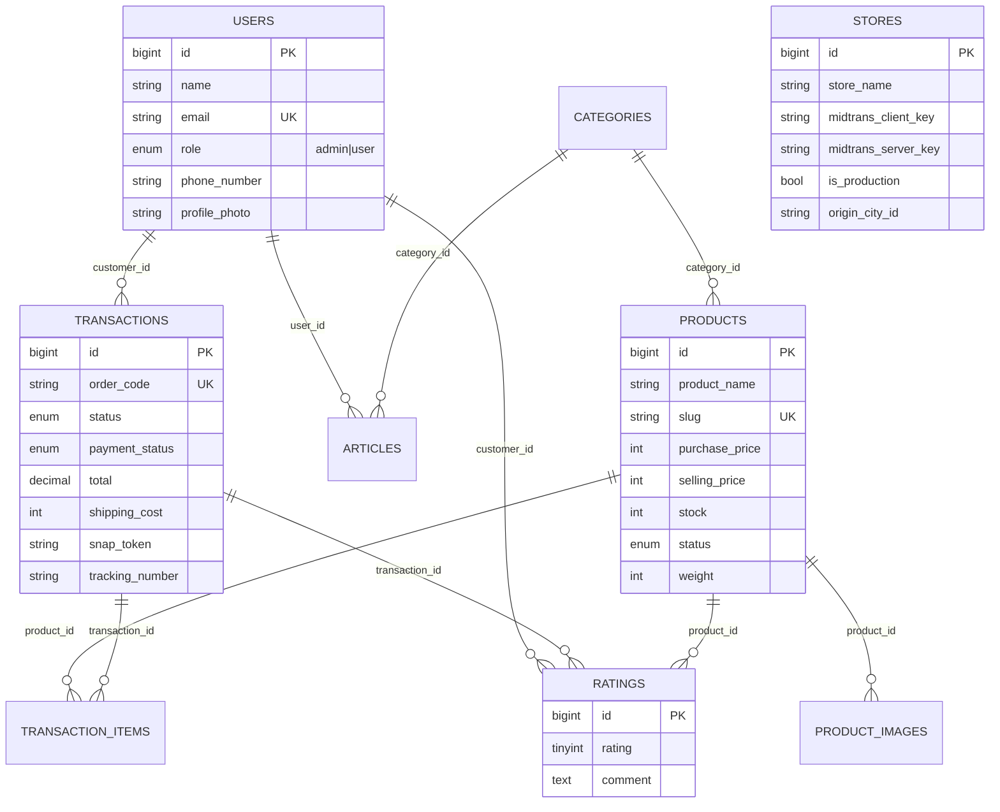
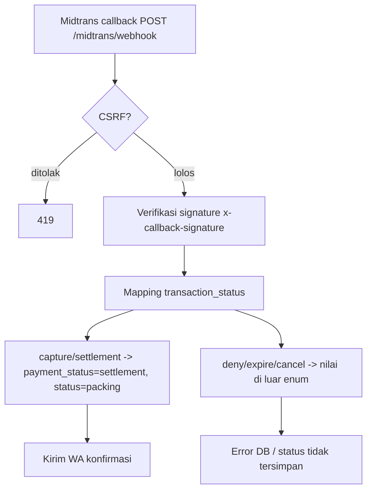
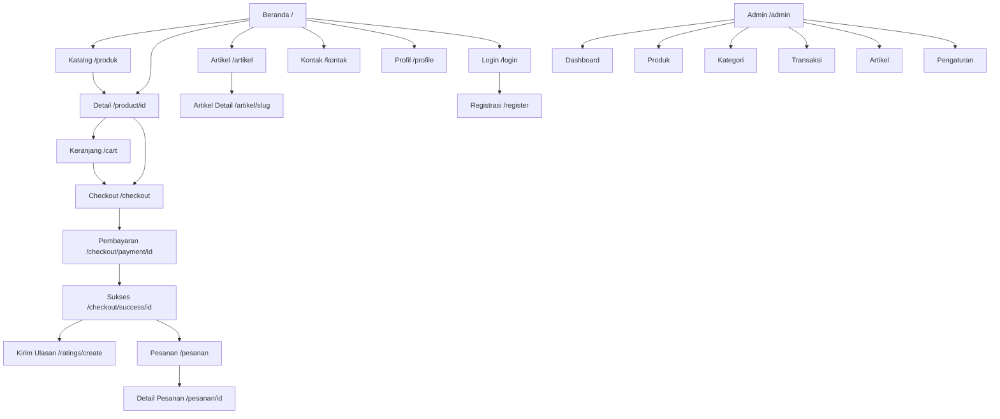

	# PROJECT TECHNICAL SPECIFICATION
## InstanWeb — Marketplace Produk UMKM (Laravel 12 + Filament 4)

> **Metodologi:** Dokumen ini disusun melalui pembacaan langsung berkas repositori dalam mode **read-only** (tidak ada berkas aplikasi yang diubah). `vendor/` dan `node_modules/` tidak tersedia di repositori, sehingga `php artisan route:list` **tidak dijalankan**; daftar rute disusun dari `routes/web.php` dan konvensi Filament (`discoverResources`). Setiap pernyataan diberi label **VERIFIED / PARTIALLY VERIFIED / INFERRED / NOT FOUND**.
>
> **Tanggal analisis:** 1 November 2026

---

## 1. Executive Summary

**VERIFIED.** InstanWeb (`composer.json` → `"name": "instanweb/marketplace-umkm"`) adalah aplikasi e-commerce **single-store** berbasis Laravel 12 dengan panel admin Filament v4 dan frontend Blade + Tailwind CSS v4.

Walaupun branding menyebut "marketplace UMKM", implementasi saat ini adalah **toko tunggal**: hanya ada satu `Store` (`Store::first()`), tidak ada entitas penjual/seller, tidak ada relasi produk→toko, dan tidak ada pemisahan pesanan per penjual. Hal ini diakui eksplisit di `README.md` ("struktur saat ini masih berorientasi pada satu toko").

Arsitektur ringkas:

- **Publik/Customer**: Controller klasik (`HomeController`, `ArticleController`, `ProfilController`, `ReviewController`, `GoogleLoginController`) + Blade view. Keranjang belanja disimpan di **session** (bukan tabel `carts`).
- **Pembayaran**: Midtrans Snap (`app/Services/MidtransService.php`) + webhook `POST /midtrans/webhook` (`MidtransWebhookController`).
- **Pengiriman**: integrasi RajaOngkir (Komerce API) via service container `'rajaongkir'` (`RajaOngkirServiceProvider`).
- **Notifikasi**: WhatsApp via Fonnte, dipanggil dari `HomeController::sendMessage()`.
- **Admin**: Filament panel `/admin` dengan 4 Resource (Produk, Kategori, Transaksi, Artikel), 2 Page (Dashboard, Pengaturan), 4 Widget.

**Kondisi teknis saat ini: TIDAK berjalan normal pada lingkungan case-sensitive (Linux).** Terdapat satu *parse error* pada layout utama dan beberapa ketidaksesuaian skema yang membuat alur inti (checkout → pembayaran → status pesanan) tidak dapat diselesaikan. Detail pada §12.

---

## 2. Technology Stack

### 2.1 Backend (dari `composer.json` + `composer.lock`)

| Komponen | Versi terverifikasi | Keterangan |
|---|---|---|
| PHP | `^8.2` (platform lock) | Runtime lokal terdeteksi PHP 8.4.27 |
| laravel/framework | **v12.33.0** | Framework utama |
| filament/filament | **v4.0.0** | Panel admin |
| livewire/livewire | v3.6.4 | Basis Filament |
| laravel/socialite | v5.23.0 | Login Google |
| midtrans/midtrans-php | v2.6.2 | Payment gateway |
| laravel/tinker | v2.10.1 | REPL |
| blade-ui-kit/blade-heroicons | 2.6.0 | Ikon (dependency Filament) |
| guzzlehttp/guzzle | 7.10.0 | HTTP client (RajaOngkir) |

Dev: phpunit 11.5.42, laravel/pint 1.25.1, fakerphp/faker, mockery, collision, sail, pail.

**Autoload khusus:** `composer.json` → `autoload.files: ["app/Helpers/StoreHelper.php"]` (fungsi global `store()`).

### 2.2 Frontend (`package.json`, `vite.config.js`)

| Komponen | Versi | Bukti |
|---|---|---|
| tailwindcss | `^4.0.0` | `package.json` |
| @tailwindcss/vite | `^4.0.0` | plugin Vite |
| vite | `^7.0.7` | bundler |
| laravel-vite-plugin | `^2.0.0` | integrasi |
| axios | `^1.11.0` | `resources/js/bootstrap.js` |
| concurrently | `^9.0.1` | script `composer dev` |

**Tidak ada** Livewire component kustom, Alpine.js eksplisit, React/Vue, atau TypeScript. Interaksi frontend 100% JavaScript vanilla inline di dalam Blade.

### 2.3 Database

`config/database.php` default `env('DB_CONNECTION','sqlite')`, tetapi `.env.example` menetapkan **MySQL** (`DB_DATABASE=instanweb`). `phpunit.xml` memakai SQLite `:memory:`. → **VERIFIED**: produksi/dev = MySQL.

### 2.4 Infrastructure & Integrasi Eksternal

| Layanan | Konfigurasi | Status |
|---|---|---|
| Midtrans Snap | key disimpan di tabel `stores` (bukan `.env`) | Terpasang, sebagian tidak konsisten |
| RajaOngkir (Komerce) | `config/services.php` → `rajaongkir.*` | Terpasang |
| Google OAuth | `config/services.php` → `google.*` | Terpasang |
| Fonnte (WhatsApp) | `env('WA_API_TOKEN')` langsung di controller | **Tidak ada** di `.env.example` |
| Session/Cache/Queue | `database` driver | Terpasang |

### 2.5 Build & Dev Commands (`composer.json` scripts)

- `composer setup`: install, `.env`, key, migrate, npm install, build.
- `composer dev`: serve + queue:listen + pail + vite (concurrently).
- `composer test`: `config:clear` + `artisan test`.
- `post-autoload-dump`: `filament:upgrade`.
- Frontend: `npm run dev`, `npm run build`.

### 2.6 Testing

| Berkas | Isi | Status |
|---|---|---|
| `tests/Feature/ExampleTest.php` | `GET /` → 200 | Contoh bawaan, **akan gagal** (lihat C1/C4) |
| `tests/Unit/ExampleTest.php` | `assertTrue(true)` | Placeholder |
| `tests/TestCase.php` | Base kosong | — |

**Tidak ada test untuk alur bisnis** (cart, checkout, pembayaran, ulasan). `database/factories/` hanya `UserFactory`.

---

## 3. Project Directory Structure

```text
instanweb/
├── app/
│   ├── Filament/
│   │   ├── Pages/           Dashboard.php, Pengaturan.php
│   │   ├── Resources/
│   │   │   ├── Articles/    ArticleResource + Pages/ Schemas/ Tables/
│   │   │   ├── Categories/  CategoryResource + Pages/ Schemas/ Tables/
│   │   │   ├── Products/    ProductResource + Pages/ Schemas/ Tables/ RelationManagers/
│   │   │   └── Transactions/TransactionResource + Pages/ Schemas/ Tables/ RelationManagers/
│   │   └── Widgets/         LatestOrdersWidget, OrderChartWidget, OrderLineChartWidget, OverviewStatsWidget
│   ├── Helpers/StoreHelper.php          # fungsi global store() + cache forever
│   ├── Http/
│   │   ├── Controllers/     8 controller (lihat §4)
│   │   ├── Kernel.php       # TIDAK dipakai Laravel 12
│   │   └── Middleware/      Authenticate, IsAdmin, IsUser (tidak terdaftar)
│   ├── Models/              10 model
│   ├── Providers/           AppServiceProvider, Filament/AdminPanelProvider, RajaOngkirServiceProvider
│   └── Services/MidtransService.php
├── bootstrap/
│   ├── app.php              # withRouting/withMiddleware/withExceptions (semua kosong)
│   └── providers.php        3 provider
├── config/                  9 berkas (app, auth, cache, database, filesystems, logging, mail, queue, session, services)
├── database/
│   ├── factories/UserFactory.php
│   ├── migrations/          27 migrasi
│   └── seeders/DatabaseSeeder.php
├── public/                  index.php, .htaccess, images/, css+js (aset Filament)
├── resources/
│   ├── css/app.css          entry Tailwind v4
│   ├── js/app.js, bootstrap.js
│   └── views/               19 Blade + layouts/app.blade.php + filament/pages/pengaturan.blade.php
├── routes/                  web.php, console.php (tidak ada api.php/channels.php)
├── storage/                 app/public, framework/{cache,sessions,testing,views}
├── tests/                   2 test contoh
├── AGENTS.md, README.md, TODO.md, composer.json/lock, package.json/lock, vite.config.js, phpunit.xml
```

**Catatan penting:** `vendor/`, `node_modules/`, `public/build`, `public/storage` **tidak ada** (lihat `.gitignore`) → aplikasi tidak dapat langsung dijalankan tanpa `composer install && npm run build && php artisan storage:link`.

---

## 4. Application Architecture

### 4.1 Bootstrapping — **VERIFIED**

`bootstrap/app.php` hanya mendaftarkan `web`, `console`, dan health `/up`. **Tidak ada** registrasi middleware alias, `redirectGuestsTo`, pengecualian CSRF, atau penjadwalan. `bootstrap/providers.php` memuat `AppServiceProvider`, `AdminPanelProvider`, `RajaOngkirServiceProvider`.

`app/Http/Kernel.php` **ada tetapi tidak dipakai** pada Laravel 11/12 — akibatnya alias `isAdmin`/`isUser` dan `App\Http\Middleware\Authenticate` **tidak pernah aktif**.

### 4.2 Lapisan HTTP

| Controller | Tanggung jawab | View |
|---|---|---|
| `HomeController` | katalog, detail, search JSON, cart (session), checkout, pembayaran, pesanan, WA notif | home, products, Detail, Cart, Checkout, Checkout/Payment, Checkout/Success, pesanan, detail-pesanan |
| `GoogleLoginController` | login email, register email, OAuth Google, logout | Auth/login, Auth/register |
| `ProfilController` | profil + upload foto | Profil |
| `ReviewController` | CRUD rating/ulasan | review/create |
| `ArticleController` | listing + detail artikel | articles/index, articles/show |
| `RajaOngkirController` | proxy provinsi/kota/kecamatan/ongkir/waybill | JSON |
| `MidtransWebhookController` | callback pembayaran | JSON |

`HomeController` menyuntikkan `MidtransService` di **constructor** — implikasi kritis dibahas di §12 (C4).

### 4.3 Model Layer

10 model: `User`, `Product`, `Category`, `ProductImage`, `Transaction`, `TransactionItem`, `Rating`, `Review`, `Store`, `Article`.

Relasi terverifikasi: `Product belongsTo Category`, `Product hasMany ProductImage`, `Category hasMany Product`, `Transaction belongsTo User (customer)`, `Transaction hasMany TransactionItem`, `TransactionItem belongsTo Transaction|Product`, `Rating belongsTo User(customer_id)|Product|Transaction`, `Article belongsTo User|Category`, `ProductImage belongsTo Product`.
**`User` tidak memiliki relasi apa pun** (tidak ada `transactions()`, `ratings()`).

### 4.4 Service Layer

- `App\Services\MidtransService` — konfigurasi statis `Midtrans\Config` dari `Store::first()`; membangun `item_details`, `customer_details`, `callbacks`.
- Container `'rajaongkir'` (anonymous class) — HTTP wrapper dengan header/bearer auth, endpoint configurable.
- `store()` helper global — `cache()->rememberForever('store_data', fn() => Store::first())`.

### 4.5 Filament / Livewire

`AdminPanelProvider`: id `admin`, path `/admin`, warna `Amber`, brand "InstanWeb", auto-discover Resources/Pages/Widgets, `authMiddleware` = `[Filament Authenticate, IsAdmin]`.

### 4.6 Diagram Interaksi

```mermaid
graph TD
    U[Pengunjung/Customer] -->|HTTP| R[routes/web.php]
    R --> C[Controllers]
    C --> M[Eloquent Models]
    C --> V[Blade Views]
    C --> S[MidtransService]
    C -->|app('rajaongkir')| RO[RajaOngkir Provider]
    M --> DB[(MySQL)]
    V --> T[Tailwind v4 + Vite]
    C -.session cart.-> SES[(Session DB)]
    A[Admin] -->|/admin| F[Filament Panel]
    F --> IsAdmin[IsAdmin Middleware]
    F --> FM[Models]
    MG[Midtrans] -->|webhook| WH[MidtransWebhookController]
    FN[Fonnte WA API] <--> C
```

---

## 5. Database Specification

### 5.1 Tabel & Kolom (dari `database/migrations/`)

**users** (`0001_01_01_000000`)

| Kolom | Tipe | Constraint |
|---|---|---|
| id | bigint PK | |
| name | string | not null |
| email | string | unique |
| email_verified_at | timestamp | nullable |
| phone_number | string | nullable |
| role | enum('admin','user') | default 'user' |
| password | string | |
| address | string | nullable |
| profile_photo | string | nullable (migrasi 2025_11_12) |
| remember_token | string | nullable |
| timestamps | | |

**products** (`2025_10_10_070800` + `..._121720` + `..._042746`)

| Kolom | Tipe | Catatan |
|---|---|---|
| id | bigint PK | |
| product_name | string | |
| slug | string | unique; diisi otomatis di `booted()` |
| description | longText | |
| purchase_price | integer | **harga beli** |
| selling_price | integer | **harga jual** |
| stock | integer | |
| status | enum('active','inactive') | default active |
| image | string | **NOT NULL** (typo `nullbaelble()`) |
| category_id | FK categories | nullable, cascadeOnDelete |
| weight | integer | nullable (gram) |
| timestamps | | |

**categories**: id, category_name (unique), slug, icon (nullable), timestamps.

**product_images**: id, product_id (FK cascade), image_file, timestamps.

**stores**: id, store_name, address?, logo?(255), description?, instagram?, tiktok?, whatsapp?, facebook?, shopee?, tokopedia?, midtrans_client_key?, midtrans_server_key?, is_production (bool, default false), origin_city_id?, origin_district_id?, timestamps.

**transactions**

| Kolom | Tipe | Catatan |
|---|---|---|
| id | bigint PK | |
| order_code | string | unique |
| customer_id | FK users | cascade |
| phone_number | string | nullable |
| address | text | not null |
| status | enum(pending,packing,sent,done,cancelled) | default pending |
| total | decimal(15,2) | default 0 (sudah termasuk ongkir) |
| shipping_cost | integer | nullable |
| notes | text | nullable |
| province, city, district, postal_code, courier, courier_service, tracking_number | string | nullable |
| payment_method | enum('midtrans') | default midtrans |
| snap_token | string | nullable |
| payment_status | enum(pending,**paid**,**failed**,**expired**) | default pending |
| timestamps | | |

**transaction_items**: id, transaction_id (FK cascade), product_id (FK cascade), price decimal(15,2), quantity int, timestamps.

**ratings**: id, customer_id (FK users cascade), product_id (FK cascade), transaction_id (FK cascade), rating tinyint (1–5, default 1), comment text?, image string?, timestamps, **unique(customer_id, product_id, transaction_id)**.

**articles**: id, title, slug (unique), description (text; hasil rename dari `content`), image?, thumbnail?, user_id (FK users cascade), category_id (FK categories nullable, set null), timestamps.

Tabel framework: `password_reset_tokens`, `sessions`, `cache`, `cache_locks`, `jobs`, `job_batches`, `failed_jobs`.

### 5.2 ER Diagram



**Entitas e-commerce yang TIDAK ADA (NOT FOUND):** `carts`, `cart_items`, `wishlists`, `coupons/vouchers`, `shipping_addresses`, `payments` (hanya kolom di transactions), `sellers/stores per user`, `inventory_logs`, `product_variants`.

---

## 6. Route Specification

Sumber: `routes/web.php`. Semua rute berada pada middleware group `web` (default framework), sehingga **CSRF aktif** dan session tersedia.

### 6.1 Publik (tanpa auth)

| Method | URI | Name | Handler | Tujuan |
|---|---|---|---|---|
| GET | `/` | `home` | HomeController@index | Beranda + 8 produk + rating |
| GET | `/produk` | `products` | HomeController@products | Katalog + filter |
| GET | `/product/{id}` | `product.show` | HomeController@Product | Detail produk + ulasan |
| GET | `/kontak` | `kontak` | HomeController@kontak | Info toko |
| GET | `/api/products/search` | `products.search` | HomeController@searchProducts | JSON autocomplete |
| GET | `/artikel` | `articles.index` | ArticleController@index | Listing artikel (paginate 10) |
| GET | `/artikel/{article}` | `articles.show` | ArticleController@show | Detail (binding `slug`) |
| GET | `/rajaongkir/provinces` | `rajaongkir.provinces` | RajaOngkirController@getProvinces | JSON |
| GET | `/rajaongkir/cities` | `rajaongkir.cities` | ...@getCities | JSON (?province_id) |
| GET | `/rajaongkir/districts` | `rajaongkir.districts` | ...@getDistricts | JSON (?city_id) |
| GET | `/rajaongkir/couriers` | `rajaongkir.couriers` | ...@getCouriers | 17 kurir statis |
| POST | `/rajaongkir/cost` | `rajaongkir.cost` | ...@getShippingCost | Kalkulasi ongkir |
| POST | `/rajaongkir/waybill` | `rajaongkir.waybill` | ...@getWaybill | Lacak resi |
| GET | `/google/redirect` | `google.redirect` | GoogleLoginController@redirectToGoogle | OAuth |
| GET | `/google/callback` | `google.callback` | ...@handleGoogleCallback | OAuth callback |
| GET | `/login` | `login.form` | ...@loginform | Form login |
| POST | `/login/email` | `login.email` | ...@loginEmail | Login kredensial |
| GET | `/register` | `register.form` | ...@registerForm | Form daftar |
| POST | `/register/email` | `register.email` | ...@registerEmail | Daftar |
| POST | `/logout` | `logout` | ...@logout | Logout |
| POST | `/midtrans/webhook` | *(tanpa name)* | MidtransWebhookController@handleWebhook | Callback Midtrans |

### 6.2 Customer (middleware `auth`)

| Method | URI | Name | Handler |
|---|---|---|---|
| POST | `/add-to-cart` | `addToCart` | HomeController@addToCart |
| GET | `/cart` | `cart` | @viewCart |
| PATCH | `/cart/{id}` | `updateCart` | @updateCart |
| DELETE | `/cart/{id}` | `removeCart` | @removeCart |
| GET | `/checkout` | `checkout.page` | @checkoutPage |
| POST | `/checkout` | `checkout` | @checkout |
| GET | `/checkout/payment/{id}` | `checkout.payment` | @checkoutPayment |
| GET | `/checkout/success/{id}` | `checkout.success` | @checkoutSuccess |
| GET | `/transaction/{id}/snap-token` | `transaction.getSnapToken` | @getSnapToken |
| GET | `/pesanan` | `orders` | @orders |
| GET | `/pesanan/{id}` | `order.detail` | @orderDetail |
| DELETE | `/pesanan/{id}` | `order.delete` | @deleteOrder |
| GET | `/profile` | `profil` | ProfilController@index |
| PUT | `/profil` | `profil.update` | ProfilController@update |
| GET | `/ratings/create` | `ratings.create` | ReviewController@create |
| POST | `/ratings` | `ratings.store` | ReviewController@store |
| PUT | `/ratings/{rating}` | `ratings.update` | ReviewController@update |
| DELETE | `/ratings/{rating}` | `ratings.destroy` | ReviewController@destroy |

### 6.3 Administrator (Filament, `/admin`)

Dibuat otomatis oleh Filament dari `getPages()` tiap resource:

| Area | URI (pola) | Resource/Page |
|---|---|---|
| Dashboard | `/admin` | `App\Filament\Pages\Dashboard` |
| Produk | `/admin/products`, `/create`, `/{record}`, `/{record}/edit` | ProductResource |
| Kategori | `/admin/categories`, `/create`, `/{record}/edit` | CategoryResource |
| Transaksi | `/admin/transactions`, `/create`, `/{record}/edit` | TransactionResource |
| Artikel | `/admin/articles`, `/create`, `/{record}/edit` | ArticleResource |
| Pengaturan | `/admin/pengaturan` | Page `Pengaturan` |

Akses: `Filament\Http\Middleware\Authenticate` + `App\Http\Middleware\IsAdmin` (role harus `admin`).

### 6.4 Temuan routing — **VERIFIED**

1. `route('login')` **tidak pernah didefinisikan** (yang ada `login.form`), tetapi dirujuk oleh: middleware `auth` bawaan Laravel, `ProfilController:19`, `AdminPanelProvider:66`, `welcome.blade.php:35`.
2. `route('user.homepage')` dirujuk di `AdminPanelProvider:33,75` dan `IsAdmin:26` — **tidak ada**.
3. `route('admin.dashboard')` dirujuk di `IsUser:27` — **tidak ada**.
4. `POST /midtrans/webhook` berada di group `web` tanpa pengecualian CSRF → **berpotensi 419** untuk request server-to-server.
5. Prefix `/api/...` berada di file `web.php` (bukan `api.php`), sehingga ikut CSRF & session — tidak konsisten.
6. Nama rute `product.show` memakai parameter `{id}` (bukan model binding) — tidak konsisten dengan `articles.show` yang memakai binding slug.

---

## 7. Customer Features

| Fitur | Status | Bukti |
|---|---|---|
| Beranda + slider 3 gambar | **VERIFIED** | `resources/views/home.blade.php`, `public/images/gambar1-3.jpeg` |
| Sorotan 8 produk terbaru + rating agregat | **VERIFIED** | `HomeController@index` |
| Katalog + filter kategori | **VERIFIED** | `products.blade.php`, `HomeController@products` |
| Pencarian realtime (debounce 300ms) | **VERIFIED** | `products.blade.php:123-208` + `/api/products/search` |
| Detail produk: galeri thumbnail, stok, qty stepper, "Beli Sekarang", "Tambah ke Keranjang" | **VERIFIED** | `Detail.blade.php` |
| Ulasan produk (rating bintang, komentar, foto) | **VERIFIED** | `Detail.blade.php:37-83`, `ReviewController` |
| Keranjang berbasis session (tambah/ubah qty/hapus) | **VERIFIED** | `HomeController@addToCart/viewCart/updateCart/removeCart` |
| Checkout: alamat, provinsi/kota/kecamatan (RajaOngkir), kurir + layanan, ongkir, catatan | **VERIFIED** | `Checkout.blade.php` (439 baris) |
| Pembayaran Midtrans Snap | **PARTIALLY VERIFIED** | `Checkout/Payment.blade.php`; client key tidak terkonfigurasi |
| Halaman sukses + form ulasan inline | **VERIFIED** | `Checkout/Success.blade.php` |
| Riwayat pesanan + tab status | **VERIFIED (UI)** / **PARTIALLY** (filter via JS, bukan server) | `pesanan.blade.php` |
| Detail pesanan + timeline pelacakan | **VERIFIED (UI)**, timeline memakai tanggal estimasi palsu | `detail-pesanan.blade.php` |
| Pembatalan pesanan (khusus `pending`) + restock | **VERIFIED** | `HomeController@deleteOrder` |
| Profil: nama, email, telepon, alamat, foto, ubah password | **VERIFIED** | `Profil.blade.php`, `ProfilController` |
| Login email + Google OAuth | **VERIFIED** | `GoogleLoginController`, `Auth/login.blade.php` |
| Registrasi email + Google | **VERIFIED** | `Auth/register.blade.php` |
| Artikel/blog + share (WA, FB, X, copy link) | **VERIFIED** | `articles/index`, `articles/show` |
| Halaman kontak (info toko, sosmed, marketplace) | **VERIFIED** | `kontak.blade.php` |
| Notifikasi WhatsApp otomatis setelah order | **VERIFIED (kode)**, kredensial tidak ada | `HomeController@sendMessage/sendOrderConfirmation` |
| Lupa password / reset password | **NOT FOUND** (link `#`) | `Auth/login.blade.php` |
| Wishlist | **NOT FOUND** | — |
| Manajemen alamat tersimpan | **NOT FOUND** (hanya 1 kolom `address` di users) | — |
| Lacak resi mandiri oleh customer | **NOT FOUND** (endpoint ada, UI tidak) | `RajaOngkirController@getWaybill` |
| Kupon/diskon | **NOT FOUND** | — |
| Multi-UMKM / akun penjual | **NOT FOUND** | `README.md` |

---

## 8. Administrator Features

| Modul | Implementasi | CRUD | Detail |
|---|---|---|---|
| Dashboard | `Filament/Pages/Dashboard.php` + 4 widget | — | Statistik produk/kategori/pesanan (chart statis), bar chart 7 hari, line chart 7 hari, tabel 10 pesanan terbaru |
| Produk | `ProductResource` | Create/Read/Update/Delete(bulk) | Form: nama, slug (manual), kategori, deskripsi, harga beli, harga jual, stok, status, gambar utama. Infolist lengkap. RelationManager `ImagesRelationManager` (galeri: upload, edit, hapus) |
| Kategori | `CategoryResource` | Create/Update/Delete(bulk) | nama, slug (disabled/auto), ikon upload |
| Transaksi | `TransactionResource` | Create/Update/Delete(bulk) | Form read-only + `status` ToggleButtons (5 status); kurir 4 pilihan; resi otomatis; RelationManager `ItemsRelationManager` (tampilan saja, aksi edit/hapus dimatikan) |
| Artikel | `ArticleResource` | Create/Update/Delete(bulk) | judul, slug, RichEditor, gambar, thumbnail, `user_id` hidden (author) |
| Pengaturan | `Page Pengaturan` + `filament/pages/pengaturan.blade.php` | Update | Info toko, logo, deskripsi, sosmed, marketplace, **Midtrans client/server key + mode produksi**, origin city/district RajaOngkir |
| Manajemen user/customer | **NOT FOUND** | — | Tidak ada UserResource |
| Manajemen ulasan | **NOT FOUND** | — | Tidak ada RatingResource |
| Laporan/analitik lanjutan | **PARTIALLY** | — | Hanya 4 widget dasar, tanpa filter periode/ekspor |
| Manajemen pembayaran | **PARTIALLY** | — | Hanya kolom `payment_status` di tabel transaksi |
| Manajemen stok/inventori | **PARTIALLY** | — | Hanya field `stock` pada produk |

**Perbedaan customer vs admin:** customer memakai Blade klasik (tanpa komponen), admin memakai Filament (Livewire). Tidak ada UI admin untuk mengelola `Rating`, `Store` (kecuali 1 page), maupun `User`.

---

## 9. Business Process

### 9.1 Alur Belanja (customer) — **VERIFIED**

```mermaid
flowchart TD
    A[Beranda / Produk] --> B[Detail Produk]
    B -->|Tambah ke Keranjang| C{Login?}
    C -- tidak --> L[redirect ke auth middleware]
    C -- ya --> D[addToCart: simpan ke session cart]
    D --> E[Cart: ubah qty / hapus]
    B -->|Beli Sekarang : direct=1| F[Checkout page]
    E --> F
    F --> G[Pilih provinsi/kota/kecamatan + kurir + layanan]
    G --> H[RajaOngkir cost -> ongkir]
    H --> I[POST /checkout]
    I --> J[Validasi input + cek stok]
    J --> K[Transaction::create status=pending, payment_status=pending]
    K --> L2[decrement stock + TransactionItem]
    L2 --> M[Midtrans Snap createTransaction -> snap_token]
    M --> N[Kirim WA Fonnte]
    N --> O[Redirect /checkout/payment/id]
    O --> P[snap.pay]
    P --> Q[/checkout/success/id]
    Q --> R[Customer kirim ulasan]
```

### 9.2 Alur Admin

```mermaid
flowchart TD
    A[Login Google / email] --> B{role == admin?}
    B -- tidak --> C[ditolak IsAdmin -> route user.homepage TIDAK ADA]
    B -- ya --> D[/admin Dashboard]
    D --> E[Kelola Produk/Kategori/Artikel]
    D --> F[Kelola Transaksi]
    F --> G[Ubah status: pending -> packing -> sent -> done]
    G --> H{status == sent?}
    H -- ya --> I[Model Transaction auto-generate tracking_number]
    H -- tidak --> J[selesai]
    I --> J
```

### 9.3 Alur Pembayaran (webhook) — **PARTIALLY VERIFIED / berisiko**



### 9.4 Alur Ulasan

`ReviewController@store` memerlukan: user memiliki transaksi, produk ada di transaksi, **status transaksi ∈ {success, done}**, belum pernah memberi rating untuk kombinasi (customer, produk, transaksi). Karena `success` tidak ada di enum dan `done` hanya bisa diset admin, ulasan praktis **bergantung pada aksi admin**.

### 9.5 Alur Pengaturan Toko

`Pengaturan@save` → `Store::fill()->save()` → `cache()->forget('store_data')` → footer/kontak/notifikasi WA ikut berubah. (**VERIFIED**, konsisten.)

---

## 10. Frontend & UI Components

### 10.1 Arsitektur CSS — **VERIFIED**

- Entry tunggal: `resources/css/app.css` → `@import 'tailwindcss';` (Tailwind v4, **tanpa** `tailwind.config.js`).
- Direktif `@source` untuk scanning: `vendor/laravel/framework/.../Pagination`, `storage/framework/views/*.php`, `../**/*.blade.php`, `../**/*.js`.
- `@theme` hanya mendefinisikan `--font-sans: 'Instrument Sans'` (font tidak di-load eksplisit).
- **Tidak ada** token warna/spacing kustom di CSS, **tidak ada** `@layer components`, **tidak ada** `@utility`.
- Styling utama justru ditulis sebagai `<style>` inline ~72 baris di `layouts/app.blade.php`, memakai **override `!important`** besar-besaran (`.bg-white`, `.text-gray-900`, `input`, dll.) untuk memaksa tema gelap. Ini membuat utility Tailwind di view tidak lagi deterministik.

### 10.2 Layout & Komponen

| Elemen | Berkas | Catatan |
|---|---|---|
| Layout utama | `resources/views/layouts/app.blade.php` (309 baris) | Navbar + dropdown profil (hover), cart badge, footer sosmed |
| Navbar | idem:89-228 | Menu: Beranda, Produk, Artikel, Kontak, search, profil/cart/login, hamburger CSS-only (`peer-checked`) |
| Footer | idem:234-305 | Instagram/TikTok/Facebook/WhatsApp/Shopee/Tokopedia dari `store()` |
| Komponen Blade reusable | **NOT FOUND** | Tidak ada `resources/views/components/`; semua markup diduplikasi |
| Layout admin | Filament built-in | — |

### 10.3 Pola UI per Halaman

| Halaman | Grid/responsif | Interaksi JS |
|---|---|---|
| home | slider autoplay 4s, grid 2→3→4 kolom | slider, indicator, hover scale |
| products | grid 2→4 kolom, filter bar | debounce fetch + render ulang HTML |
| Detail | 1→2 kolom, sticky panel kanan | galeri (onclick ganti src), qty stepper, 2 tombol aksi |
| Cart | 2 kolom + sidebar sticky | update qty otomatis submit form |
| Checkout | 2 kolom, form kiri, ringkasan kanan | cascading region select, hitung ongkir, update total |
| Payment | 2 kolom | loading spinner 2s → snap.pay otomatis |
| Success | 1 kolom | form rating inline |
| pesanan | kartu per transaksi, tab status | filter tab client-side |
| detail-pesanan | 2 kolom (2/1) | timeline statis |
| Profil | form 2 kolom | preview foto FileReader |
| review/create | 1 kolom | star rating hover, preview gambar |

### 10.4 Konsistensi Visual

Bahasa desain **tidak konsisten**: beranda bertema gelap (`slate-950`, `bg-slate-900`), halaman lain bertema terang (`bg-white`, `gray-100`) namun dipaksa gelap oleh override global; palet aksen bercampur **biru** (`#087eaa`), **oranye** (`#ea741c`), **hitam**. Ikon: campuran emoji (🛒, ✨, 📞) dan SVG inline. Font: Instrument Sans dideklarasikan tetapi tidak di-load.

### 10.5 Aksesibilitas & Error State

- `alt` sebagian kosong (`Detail.blade.php` img ulasan), label form ada, namun **tidak ada** `aria-live` untuk notifikasi; flash message hanya `session('success')` (tidak ada `error` global).
- Empty state: cart, katalog, ulasan, pesanan tersedia. **Error state** hanya di form checkout (province/city/district/service error).
- Flash `session('error')` dari `checkout` **tidak pernah ditampilkan** di view manapun.

---

## 11. Authentication & Authorization

| Aspek | Implementasi | Status |
|---|---|---|
| Guard | `web` (session), provider `users` → `App\Models\User` | VERIFIED (`config/auth.php`) |
| Login kredensial | `Auth::attempt` (tanpa `remember`) | VERIFIED |
| Login Google | Socialite stateless, auto-create user role `user`, password acak 6 digit | VERIFIED |
| Registrasi | Validasi `name|email|unique|password|min:8|confirmed`, langsung login | VERIFIED |
| Logout | `Auth::logout()` (tanpa `invalidate`/`regenerateToken`) | VERIFIED |
| Verifikasi email | `MustVerifyEmail` dikomentari | NOT ACTIVE |
| Reset password | Tabel ada, route & UI tidak ada | NOT FOUND |
| Otorisasi role | Kolom enum `role`; middleware `IsAdmin` hanya dipakai Filament | PARTIAL |
| Policies/Gates | **Tidak ada** `app/Policies`, tidak ada `Gate::define` | NOT FOUND |
| Middleware custom | `Authenticate`, `IsAdmin`, `IsUser` + `app/Http/Kernel.php` **tidak terdaftar** di `bootstrap/app.php` | DEAD CODE |
| CSRF | Default group `web` (aktif, termasuk untuk webhook) | VERIFIED |
| Rate limiting login | Tidak ada throttle | NOT FOUND |

**Matriks akses (VERIFIED):**

| Area | Guest | Customer (role=user) | Admin (role=admin) |
|---|---|---|---|
| Beranda, katalog, detail, artikel, kontak | ✔ | ✔ | ✔ |
| Keranjang/checkout/pesanan/profil/ulasan | ✘ (middleware `auth`) | ✔ | ✔ (role tidak dibatasi) |
| `/admin` | ✘ | ✘ (IsAdmin → rute tak ada) | ✔ |
| API RajaOngkir | ✔ | ✔ | ✔ |

Catatan: `IsAdmin` **tidak** membatasi customer dari route customer, dan tidak ada pembatasan admin dari halaman toko. Filament tidak memiliki Policy, sehingga seluruh admin setara.

---

## 12. Code Review Findings

Legenda: **C**=Critical, **H**=High, **M**=Medium, **L**=Low, **I**=Informational.

### Critical

**C1 — `Parse error` pada layout utama mematikan seluruh halaman customer**

- Berkas: `resources/views/layouts/app.blade.php:253`
- Kode: `<a href="https://www.tiktok.com/@{{ ltrim(store() - > tiktok, '@') }}" ...>`
- Bukti: diuji dengan PHP 8.4 → `syntax error, unexpected token ">"`. Operator `->` tidak boleh dipisah spasi. Blade mengompilasi ekspresi ini menjadi PHP di dalam view terkompilasi → **parse error** saat include.
- Dampak: semua view yang `@extends('layouts.app')` (beranda, produk, detail, cart, checkout, pesanan, profil, artikel, kontak, register, review) gagal total. Hanya `Auth/login.blade.php` (mandiri) yang selamat.
- Rekomendasi: ubah menjadi `store()->tiktok`.

**C2 — Webhook Midtrans terhalang CSRF**

- Berkas: `routes/web.php:26`, `bootstrap/app.php` (tanpa `validateCsrfTokens(except: ...)`)
- Dampak: request POST dari Midtrans tidak membawa token CSRF → **419**, sehingga pembayaran tidak pernah mengubah status pesanan.
- Rekomendasi: pindahkan ke group tanpa CSRF / daftarkan pengecualian, dan tambahkan verifikasi signature berbasis `signature_key` di body (bukan hanya header).

**C3 — Nilai `payment_status` webhook di luar definisi ENUM**

- Berkas: `MidtransWebhookController.php:96-118` vs migrasi `2025_10_24_064558` (`enum('pending','paid','failed','expired')`)
- Webhook menulis: `settlement`, `deny`, `expire`, `cancel`.
- Dampak: pada MySQL strict mode → error "Data truncated" → exception → respons 500; status tidak tersimpan. Terlihat juga di `TransactionsTable` yang mewarnai `settlement/deny/expire` (bukti nilai yang dimaksud).
- Rekomendasi: selaraskan enum (migrasi baru) atau map ke nilai yang ada.

**C4 — `MidtransService` melempar exception di constructor**

- Berkas: `app/Services/MidtransService.php:16-20`, `HomeController.php:29`
- `RuntimeException('Midtrans keys belum dikonfigurasi...')` jika `stores` kosong / key null. Karena `HomeController` menerima service di constructor, **seluruh route HomeController** (beranda, katalog, detail, kontak, cart, checkout, pesanan) menjadi 500 saat tabel `stores` belum diisi.
- Rekomendasi: lazy-resolve (`app(MidtransService::class)` di method) atau validasi/fallback tanpa exception.

**C5 — Rute `login` tidak ada**

- Berkas: `routes/web.php` (hanya `login.form`), dirujuk `ProfilController.php:19`, `AdminPanelProvider.php:66`, `welcome.blade.php:35`, dan middleware `auth` bawaan.
- Dampak: guest mengakses halaman ber-`auth` → `RouteNotFoundException` (500), bukan redirect ke halaman login.
- Rekomendasi: `->name('login')` pada `GET /login`, atau `redirectGuestsTo()` di `bootstrap/app.php`.

**C6 — Nama view tidak cocok huruf besar/kecil**

- `HomeController@viewCart` → `view('cart')` vs berkas `Cart.blade.php`; `@Product` → `view('detail')` vs `Detail.blade.php`; `ProfilController@index` → `view('profil')` vs `Profil.blade.php`; `GoogleLoginController` → `view('auth.login')`/`view('auth.register')` vs `Auth/login.blade.php`.
- Dampak: `InvalidArgumentException: View [cart] not found` di Linux/macOS-case-sensitive. Hanya berjalan di Windows.
- Rekomendasi: samakan penamaan (lowercase semua atau perbaiki pemanggilan).

### High

**H1 — Harga yang dijual memakai `purchase_price` (harga beli)**

- Berkas: `home.blade.php:121`, `products.blade.php:93,184`, `Detail.blade.php:110`, `review/create.blade.php:30`, `HomeController@addToCart:185`, `checkoutPage:262`, `searchProducts:64`.
- Dampak: pelanggan melihat & membayar harga beli; `selling_price` tidak pernah dipakai di frontend → kerugian finansial dan inkonsistensi dengan admin.

**H2 — Pengelolaan stok tidak atomik**

- `HomeController@checkout:298-306`: `decrement('stock')` per item tanpa `DB::transaction`, tanpa `lockForUpdate`, tanpa pengurangan saat `addToCart`.
- `deleteOrder:377-383`: increment stok meski produk sudah dihapus (FK cascade membuat `$item->product` null → fatal).
- Dampak: oversell, stok negatif, error pada pesanan dengan produk terhapus.

**H3 — IDOR pada halaman pembayaran & sukses**

- `checkoutPayment($id)` dan `checkoutSuccess($id)` memakai `Transaction::findOrFail($id)` **tanpa** cek `customer_id`; hanya `getSnapToken` yang memeriksa pemilik.
- Dampak: user login mana pun dapat membaca detail pesanan, alamat, nomor telepon, dan total pesanan user lain.

**H4 — Dua model untuk satu tabel `ratings`**

- `Rating` (kolom `transaction_id`, benar) vs `Review` (`$fillable` `order_id`, relasi `belongsTo(Transaction)` tanpa foreign key) → `Review` akan error jika dipakai. Duplikasi konsep.

**H5 — Ulasan bergantung status yang tak ada**

- `ReviewController@store:55` → `whereIn('status', ['success','done'])`; `success` bukan bagian enum. Alur ulasan hanya bisa setelah admin mengubah status ke `done`.

**H6 — Artikel: slug tidak dijamin & kategori tak bisa diisi**

- `ArticleForm` tidak mewajibkan `slug` dan tidak ada auto-slug di `Article` model (bandingkan `Product`/`Category` yang punya `booted()`).
- `articles.show` memakai binding `slug` → slug kosong/duplikat membuat URL rusak.
- `category_id` ada di `$fillable` + kolom + tabel admin, tetapi **tidak ada field** di form → selalu null.

**H7 — Kredensial Midtrans disimpan plaintext & ditampilkan**

- `stores.midtrans_server_key` disimpan tanpa enkripsi; `Pengaturan.php` memakai `TextInput` biasa (bukan `password()`/`revealable`), sehingga server key terlihat di UI admin dan pada response Livewire.

**H8 — `env()` dipakai di luar config**

- `HomeController:34-35` dan `MidtransWebhookController:20-21` memakai `env('WA_API_TOKEN')`. Saat `php artisan config:cache`, `env()` mengembalikan null → notifikasi WA diam-diam gagal.

**H9 — Middleware kustom tidak pernah aktif**

- `app/Http/Kernel.php` tidak dipakai Laravel 12; `bootstrap/app.php` tidak mendaftarkan alias. `IsAdmin` hanya aktif karena didaftarkan manual di `AdminPanelProvider`; `IsUser` dan `Authenticate` kustom = dead code. `IsAdmin` juga melakukan redirect ke rute yang tidak ada.

### Medium

| ID | Berkas | Temuan | Dampak |
|---|---|---|---|
| M1 | `Categories/Schemas/CategoryForm.php:26` | `FileUpload('icon')` tanpa `disk('public')`/`directory` | Ikon tersimpan di disk `local` (privat) → `asset('storage/...')` 404 |
| M2 | `Categories/Pages/ViewCategory.php` + `CategoryResource::getPages()` | ViewCategory tidak didaftarkan; `EditCategory` memakai `ViewAction` | Aksi "View" mengarah ke halaman tak ada / error; kelas mati |
| M3 | `Checkout/Payment.blade.php:40-47,97-102` | Memakai `$transaction->subdistrict` (kolom tidak ada) & status `paid/failed` | Blok wilayah tidak pernah tampil; warna status salah |
| M4 | `detail-pesanan.blade.php:171-177` | `total + shipping_cost` padahal `total` sudah termasuk ongkir | Total dobel dihitung |
| M5 | `pesanan.blade.php:5-9,37-44` | Flash message di luar `@section`; transaksi dirender dua kali (section `all` + section status) | Markup bocor sebelum layout & duplikasi DOM |
| M6 | `pesanan.blade.php:120-129` | Query `Rating::...exists()` di dalam loop item (N×M) | N+1 berat |
| M7 | `HomeController@products/index` | Agregasi rating diulang 3× (index, products, searchProducts) | Duplikasi logika |
| M8 | `HomeController@checkout:319-327` | Error Midtrans hanya di-log; transaksi tetap dibuat | Pesanan tanpa `snap_token`, user bingung |
| M9 | `HomeController@checkout:303-313` | `direct_checkout` di session tidak dibersihkan saat gagal/batal | Checkout berikutnya memakai item lama, mengabaikan cart |
| M10 | `HomeController@addToCart:168-170` | Redirect ke `checkout.page` tanpa `direct=1` | `$directCheckout` null → kembali ke cart kosong |
| M11 | `HomeController@checkoutPage:277-280` | Item cart tidak menyimpan `weight` | Ongkir dihitung 1000 g/item (default) |
| M12 | `HomeController@checkout:295` | `order_code = 'ORD-'.time().'-'.Auth::id()` | Tabrakan unique untuk 2 order/detik/user |
| M13 | `Transaction::booted()` | Resi auto-generate acak saat status `sent` | Nomor resi palsu, bukan dari kurir |
| M14 | `Transactions/RelationManagers/ItemsRelationManager.php:28-31` | Form item memakai `product_name` yang tidak ada di `transaction_items` | Create/Edit item error |
| M15 | `Transactions/Schemas/TransactionForm.php` | Banyak field `disabled()` + `required()`; tidak ada `payment_status` | Validasi bisa gagal; admin tak bisa koreksi pembayaran |
| M16 | `products` migrations:25 | `$table->string('image')-> nullbaelble()` (typo) | Kolom `image` tetap **NOT NULL**; produk tanpa gambar gagal |
| M17 | `resources/views/articles/index.blade.php` | Tag `<h2>` tidak ditutup; teks "No articles available" | Markup rusak & bahasa campur |
| M18 | `resources/views/welcome.blade.php` | Default Laravel, tidak dipakai, memanggil `route('login')/('register')` | Dead file, akan error jika diakses |
| M19 | `articles/show.blade.php:64` | `{!! $article->description !!}` | Risiko XSS tersimpan (admin) |
| M20 | `products.blade.php:172-196` | `innerHTML` dengan data produk | XSS jika nama produk memuat HTML |
| M21 | `HomeController@searchProducts` | Tidak memfilter `status=active`, tanpa throttle | Produk nonaktif muncul di autocomplete; endpoint publik beban tinggi |
| M22 | `HomeController@Product` & `products` | Tidak memfilter `status` | Produk `inactive` tetap dijual |
| M23 | `Auth/login.blade.php:85` | Link "Lupa password?" ke `#` | Fitur tidak ada |
| M24 | `GoogleLoginController@loginEmail:50` | `Auth::attempt` tanpa `remember`, checkbox diabaikan | Fitur "Ingat saya" tidak berfungsi |
| M25 | `GoogleLoginController@registerEmail:61` | Password di-hash manual (`Hash::make`) padahal cast `hashed` sudah ada | Redundan |
| M26 | `User` model | `phone` di `$fillable` tapi kolom tidak ada; tidak ada relasi | `Auth::user()->phone` selalu null; query tersebar |
| M27 | `config/services.php` | Blok `midtrans` dikomentari; `config('services.midtrans.client_key')` dipakai di 2 view | `snap.js` dimuat dengan client key kosong |
| M28 | `MidtransService` | Membaca `config('midtrans.*')` yang berkasnya tidak ada | `callbacks`/`options` selalu null |
| M29 | `public/` | `public/build` & `public/storage` absen (gitignored) | `@vite` & gambar `storage/` gagal tanpa build + `storage:link` |
| M30 | `config/app.php:81` + `.env.example` `APP_LOCALE=id` | Default config `en`, tidak ada folder `lang/` | Pesan validasi berbahasa Inggris |
| M31 | `AdminPanelProvider:33,46,62` | `->homeUrl()` dideklarasikan 2× (yang kedua menang); `->login(fn() => redirect())` menyimpang dari API Filament (mengharapkan kelas halaman) | Perilaku login admin perlu verifikasi; risiko redirect loop |
| M32 | `Filament` | Tidak ada Resource `Rating`/`User`; tidak ada Policy | Ulasan tidak termoderasi; tidak ada manajemen customer |

### Low / Informational

| ID | Temuan |
|---|---|
| L1 | Penamaan tidak konsisten: `product.show` vs `/product/{id}`, method `HomeController::Product` (kapital), `Checkout.blade.php` & `products.blade.php` campur Pascal/snake |
| L2 | Duplikasi besar CSS override `!important` di layout vs styling Tailwind di view |
| L3 | Emoji sebagai ikon (🛒, ✨, 📞) tidak konsisten dengan heroicon |
| L4 | `resources/views/detail-pesanan.blade.php:11` memakai `ml-96` untuk center (akan overflow di mobile) |
| L5 | `HomeController` mencampur 8 tanggung jawab (katalog, cart, checkout, pembayaran, pesanan, WA) → tidak ada Service/Action layer |
| L6 | `store()` dipanggil 5× di footer (di-cache, tetap tidak rapi) |
| L7 | Tidak ada CI, tidak ada `larastan`/static analysis |
| L8 | `.env.example` tidak memuat `WA_API_TOKEN`, `WA_API_URL`, `RAJAONGKIR_*` (padahal dipakai) |
| L9 | `TODO.md` hanya 1 item (sudah selesai) → tidak menggambarkan backlog |
| L10 | `public/favicon.ico` berukuran 0 byte |

---

## 13. UI/UX Design Requirements

Bagian ini menerjemahkan **fitur yang benar-benar ada** menjadi spesifikasi halaman untuk proses desain.

### 13.1 Peta Halaman & Hierarki



### 13.2 Navigasi

- **Utama (desktop)**: Beranda · Produk · Artikel · Kontak · [Search] · Profil▾ / Login · Keranjang(badge).
- **Mobile**: hamburger → daftar vertikal (Beranda, Produk, Artikel, Kontak, Profil, Pesanan, Logout/Login).
- **Profil dropdown**: Profil, Pesanan, Logout.
- **Footer**: ikon sosmed kondisional (hanya tampil jika terisi), link marketplace, copyright.

### 13.3 Spesifikasi per Halaman (Customer)

| # | Halaman | Data ditampilkan | Komponen wajib | Interaksi | Empty/Error state |
|---|---|---|---|---|---|
| 1 | Beranda | 3 banner slider; 8 produk (gambar, nama, rating bintang + jumlah, deskripsi 2 baris, harga, CTA) | Hero carousel, product card, section title | autoplay 4s, panah hover, indicator klik, add-to-cart | "Belum ada produk tersedia" |
| 2 | Katalog | produk terpaginasikan (12/hal), filter search + kategori | search bar, dropdown kategori, grid card, pagination | debounce search 300ms, ganti kategori reload | empty state teks; status loading & error (perlu ditambah) |
| 3 | Detail Produk | gambar utama + thumbnail galeri, nama, deskripsi, rating rata-rata & jumlah, stok, harga, ulasan (avatar, bintang, komentar, foto) | galeri, stepper qty, 2 CTA, review list, trust badge | ganti gambar, +/- qty (max stok), beli sekarang, tambah keranjang | "Belum ada ulasan"; stok habis (belum diimplementasi) |
| 4 | Keranjang | item (gambar, nama, harga, qty, subtotal), ringkasan (jumlah item, total) | item card, qty stepper, tombol hapus, ringkasan sticky | ubah qty auto-submit, hapus, checkout | Empty cart ilustrasi + CTA belanja |
| 5 | Checkout | form penerima/telepon/alamat, cascading region, kurir + layanan, kode pos, catatan; ringkasan item + subtotal/ongkir/total; metode pembayaran | 3 select bertingkat, select kurir, select layanan, ringkasan sticky, tombol konfirmasi | fetch provinsi→kota→kecamatan→ongkir, update total | status loading per select + pesan error per field |
| 6 | Pembayaran | order code, item, alamat/kurir/ongkir/resi, ringkasan (subtotal/ongkir/total), status pembayaran | spinner "Memproses", tombol bayar manual, modal Snap | auto `snap.pay` setelah 3s | fallback tombol manual & alert gagal |
| 7 | Sukses | kode pesanan, status, status pembayaran, total, tanggal, alamat, catatan, daftar item, form rating per item | summary card, item list, inline review form | kirim rating (star + komentar + foto), navigasi | Bila sudah dinilai → tampilkan rating tersimpan |
| 8 | Pesanan | daftar transaksi (tanggal, badge status, resi, item, total), tab status | tab filter, order card, badge, tombol Detail/Batal/Ulasan | filter tab, batal (konfirmasi), ke detail | empty state per tab |
| 9 | Detail Pesanan | item, kode, tanggal pesan/kirim, jumlah barang, status, info kirim (resi/alamat/provinsi/kota/kecamatan/kurir/layanan/ongkir), timeline 4 langkah, ringkasan | timeline stepper, info grid, summary | bayar sekarang (jika pending), kembali | timeline pending |
| 10 | Profil | avatar + upload, nama, email, telepon, alamat, ubah password | avatar uploader, form 2 kolom, tombol simpan | preview foto, submit | error per field |
| 11 | Login / Registrasi | form email+password (+remember, lupa password), tombol Google | card centered, divider "atau", OAuth button | submit, OAuth | error validasi & `session('error')` |
| 12 | Artikel | grid kartu (gambar, penulis, tanggal, CTA) + pagination | card, pagination | buka detail | "No articles available" (perlu diterjemahkan) |
| 13 | Artikel Detail | judul, penulis+avatar, tanggal, gambar, thumbnail, konten rich text, share (WA/FB/X/Copy) | hero, prose, share panel | share, copy link | — |
| 14 | Kontak | info toko (logo, nama, alamat, deskripsi), WhatsApp, sosmed, marketplace | info card, icon link | klik WA/sosmed | "Informasi toko belum tersedia" |

### 13.4 Spesifikasi Admin (Filament)

| Halaman | Elemen data | Aksi | Catatan desain |
|---|---|---|---|
| Dashboard | 3 stat card (total produk, kategori, pesanan) + chart statis; bar chart 7 hari; line chart 7 hari; tabel 10 pesanan terbaru | lihat | Perlu filter periode & metrik pendapatan |
| Produk (list) | nama, kategori, harga beli, harga jual, stok, status, gambar(toggle), tanggal | view, edit, bulk delete, search, sort | Tambah filter status/kategori & low-stock |
| Produk (form) | nama, slug, kategori, deskripsi, harga beli, harga jual, stok, status, gambar | simpan | Auto-slug & preview harga |
| Produk (view) + Galeri | semua field + relation manager gambar | tambah/edit/hapus gambar | — |
| Kategori | id, nama, slug, ikon, tanggal | edit, bulk delete | Ikon belum tampil (M1) |
| Transaksi (list) | customer, provinsi, kota, kecamatan, kode pos, order code, status, metode bayar, status bayar, kurir, layanan, ongkir, total, resi | edit, bulk delete | Tambah filter status/tanggal, ekspor |
| Transaksi (form) | order code/customer/alamat/total/catatan/metode (read-only), status (toggle), provinsi/kota/kecamatan/kodepos, kurir, layanan, resi | simpan, hapus | Tambah `payment_status` |
| Item Transaksi | produk, harga, qty, subtotal | read-only | — |
| Artikel | judul, penulis, gambar, thumbnail, kategori, tanggal | create/edit/bulk delete | Perlu field kategori & auto-slug |
| Pengaturan | info toko, logo, sosmed, marketplace, Midtrans keys, origin RajaOngkir | simpan | Server key sebaiknya masked |

### 13.5 Persyaratan Responsif

- Breakpoint nyata yang dipakai: `sm:640`, `md:768`, `lg:1024` (+ `xl` minimal).
- Grid produk: 2 kolom (mobile) → 3 (md) → 4 (lg).
- Tabel admin: gunakan scroll horizontal / stacked card di mobile.
- Perlu perbaikan: `detail-pesanan` (`ml-96`), `Checkout` (grid 2 kolom tanpa stack yang baik), navbar search (hilang di mobile — belum ada search mobile).

### 13.6 Kebutuhan Desain yang Belum Ada Implementasinya

State loading skeleton, toast global (error/success), halaman 404/419/500 kustom, halaman "stok habis", modal konfirmasi terpusat (saat ini `confirm()` native), halaman wishlist, halaman lacak resi, dan design token warna/typography yang eksplisit.

---

## 14. Missing Information

| Item | Alasan |
|---|---|
| Daftar rute runtime (`php artisan route:list`) | `vendor/` tidak ada; tidak dijalankan karena mode read-only |
| Skema database aktual | Tidak ada koneksi/kredensial; hanya migrasi |
| Isi data produksi (jumlah produk, store, transaksi) | Di luar repositori |
| Nilai env aktual | `.env` tidak ada (hanya `.env.example`); nilai sensitif tidak dibuka |
| Konfigurasi Midtrans/RajaOngkir/Google/Fonnte aktif | Kredensial tidak tersedia |
| Aset hasil build (`public/build`) | Gitignored, tidak ada |
| Perilaku UI sebenarnya di browser | Tidak menjalankan server |
| `config/midtrans.php` | Tidak ada, meski dirujuk kode |
| Berkas `CATATAN-PERUBAHAN.txt` | Dihapus pada commit `6593501` |
| Test coverage nyata | Hanya 2 test placeholder |

---

## 15. Final Recommendations

### Prioritas 0 — Blocker (wajib sebelum demo/desain diuji)

1. Perbaiki `layouts/app.blade.php:253` (`store() - > tiktok` → `store()->tiktok`). **[C1]**
2. Samakan nama view dengan nama berkas (`cart`→`Cart`, `detail`→`Detail`, `profil`→`Profil`, `auth.login`→`Auth.login`). **[C6]**
3. Definisikan rute `login` (atau `redirectGuestsTo`) dan ganti semua rujukan `user.homepage`/`admin.dashboard`. **[C5]**
4. Kecualikan `midtrans/webhook` dari CSRF + verifikasi `signature_key` di body. **[C2]**
5. Selaraskan enum `payment_status` dengan nilai webhook. **[C3]**
6. Jadikan `MidtransService` lazy agar aplikasi tetap hidup tanpa key. **[C4]**

### Prioritas 1 — Integritas bisnis

7. Ganti seluruh tampilan & perhitungan harga ke `selling_price`; simpan `selling_price` di session cart. **[H1]**
8. Bungkus checkout dalam `DB::transaction` + `lockForUpdate` stok; cegah oversell; tangani produk terhapus. **[H2]**
9. Tambahkan otorisasi kepemilikan pada `checkoutPayment`, `checkoutSuccess`, `orderDetail`. **[H3]**
10. Hapus model `Review` (duplikat) atau satukan ke `Rating`. **[H4]**
11. Wajibkan/otomatiskan slug artikel + tambahkan field kategori. **[H6]**
12. Mask/enkripsi Midtrans server key; gunakan `password()` + `revealable` di Filament. **[H7]**
13. Pindahkan `WA_API_TOKEN`/`WA_API_URL` ke `config/services.php`. **[H8]**

### Prioritas 2 — Kualitas arsitektur

14. Aktifkan middleware kustom via `bootstrap/app.php` (alias `isAdmin`, `isUser`) atau hapus `app/Http/Kernel.php`. **[H9]**
15. Ekstrak `HomeController` menjadi service/action: `CartService`, `CheckoutService`, `OrderService`, `WhatsAppNotifier`, `RatingService`.
16. Hilangkan duplikasi agregasi rating → tambahkan relasi `Product::ratings()` dan accessor `avg_rating`.
17. Tambahkan pagination + eager loading di `/pesanan` & detail; hilangkan query di dalam loop. **[M6]**
18. Tambahkan index DB: `transactions(status)`, `transactions(payment_status)`, `transactions(created_at)`, `products(status, category_id)`.
19. Perbaiki `ItemsRelationManager` (field `product_id` bukan `product_name`). **[M14]**
20. Perbaiki `icon` kategori (disk public) dan daftarkan halaman `view` kategori atau hapus `ViewAction`. **[M1, M2]**

### Prioritas 3 — Kualitas UI/UX (untuk proses desain)

21. Tetapkan **design token** nyata di `resources/css/app.css` (`@theme`: warna brand, radius, spacing, tipografi) dan hentikan override `!important` global di layout.
22. Pilih **satu** arah visual (saat ini gelap vs terang bercampur) dan terapkan konsisten pada 14 halaman customer.
23. Ekstrak komponen Blade reusable: `product-card`, `rating-stars`, `badge-status`, `empty-state`, `alert`, `modal`, `pagination`, `nav-link`.
24. Lengkapi state: loading skeleton, error inline, toast global, halaman 404/419/500, konfirmasi modal (bukan `confirm()`).
25. Tambahkan halaman yang belum ada namun dibutuhkan alur: reset password, pelacakan resi, manajemen alamat, wishlist (opsional).
26. Standarkan bahasa UI ke Bahasa Indonesia (termasuk "No articles available") dan pesan validasi (`lang/id/validation.php`).
27. Sediakan dokumentasi data per halaman untuk desainer: field `purchase_price` vs `selling_price` harus diklarifikasi agar mockup tidak mengulang bug H1.

### Prioritas 4 — Operasional

28. Tambahkan test fitur minimum: home, cart, checkout, webhook, ulasan, otorisasi.
29. Tambahkan `WA_API_TOKEN`, `RAJAONGKIR_*`, `MIDTRANS_*` ke `.env.example` beserta catatan bahwa key Midtrans kini disimpan di DB.
30. Siapkan pipeline: Pint, PHPStan/Larastan, `npm run build` di CI; dokumentasikan langkah `storage:link`.

---

## Lampiran A — Ringkasan Berkas yang Diperiksa

| Kategori | Berkas |
|---|---|
| Konfigurasi root | `composer.json`, `composer.lock`, `package.json`, `package-lock.json`, `vite.config.js`, `phpunit.xml`, `.env.example`, `.gitignore`, `README.md`, `TODO.md`, `AGENTS.md` |
| Bootstrap | `bootstrap/app.php`, `bootstrap/providers.php` |
| Config | `app`, `auth`, `cache`, `database`, `filesystems`, `logging`, `mail`, `queue`, `session`, `services` |
| Routes | `routes/web.php`, `routes/console.php` |
| Models | `Article`, `Category`, `Product`, `ProductImage`, `Transaction`, `TransactionItem`, `Rating`, `Review`, `Store`, `User` |
| Controllers | `ArticleController`, `Controller`, `GoogleLoginController`, `HomeController`, `MidtransWebhookController`, `ProfilController`, `RajaOngkirController`, `ReviewController` |
| Middleware | `Authenticate`, `IsAdmin`, `IsUser`, `Kernel` |
| Providers | `AppServiceProvider`, `AdminPanelProvider`, `RajaOngkirServiceProvider` |
| Services/Helpers | `MidtransService`, `StoreHelper` |
| Filament | 4 Resource (beserta Pages/Schemas/Tables/RelationManagers), 2 Page, 4 Widget |
| Migrations | 27 berkas di `database/migrations/` |
| Seeder/Factory | `DatabaseSeeder`, `UserFactory` |
| Views | 19 Blade + `layouts/app.blade.php` + `filament/pages/pengaturan.blade.php` |
| Assets | `resources/css/app.css`, `resources/js/app.js`, `resources/js/bootstrap.js` |
| Tests | `tests/Feature/ExampleTest.php`, `tests/Unit/ExampleTest.php`, `tests/TestCase.php` |

---

## Lampiran B — Ringkasan Status Kesiapan

Struktur fitur e-commerce sudah cukup lengkap secara fungsional (katalog → keranjang → checkout → pembayaran → pesanan → ulasan → artikel → profil → admin), tetapi **belum dapat dijalankan pada lingkungan Linux** karena C1/C6, dan alur pembayaran belum dapat menutup siklus karena C2/C3.

**Rekomendasi:** selesaikan Prioritas 0 sebelum proses desain UI/UX dimulai, agar desainer memetakan layar yang benar-benar berjalan.
