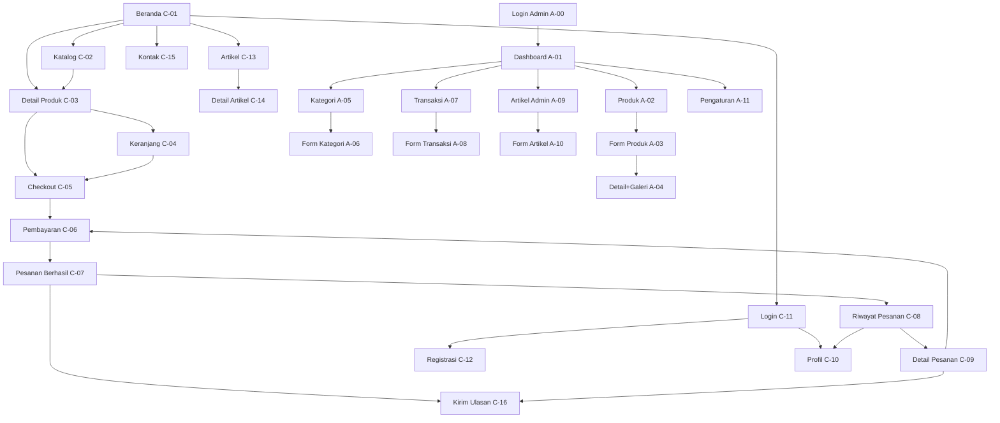
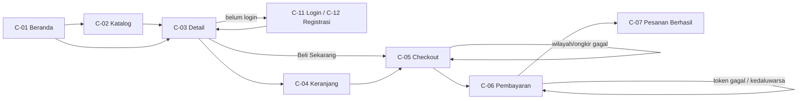
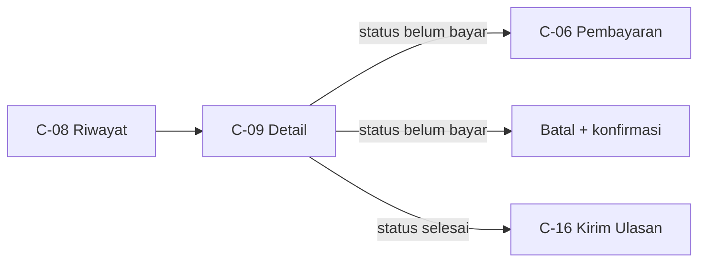
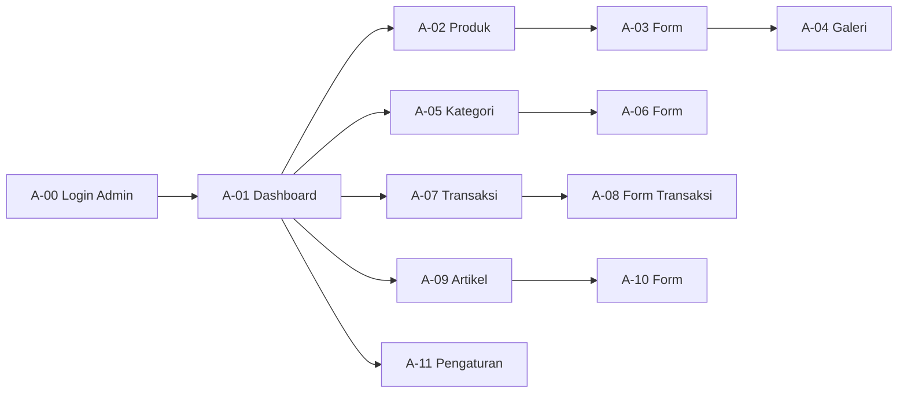

# UI/UX DESIGN BRIEF — ADVANCED EDITION
## InstanWeb — Marketplace Produk UMKM Indonesia

| Aspek | Nilai |
|---|---|
| Versi | **2.0 (Advanced)** |
| Tanggal | 1 November 2026 |
| Basis | `uiux-brief-new.md` v1.0 — **tidak diubah, hanya dibaca** |
| Status | Siap dipakai untuk produksi desain & handoff implementasi |
| Cakupan | **Desain saja.** Alur, rute, jumlah layar, dan tujuan tiap halaman identik dengan v1.0 |
| Jumlah layar | 28 blok layar = 16 customer (C-01…C-16) + 12 admin (A-00…A-11). v1.0 menyebut "27 layar (16 + 11)" — selisih hitung dijelaskan di §2 |
| Bahasa | Indonesia |
| Format harga | `Rp 1.234.000` |

> **Cara membaca dokumen ini**
> §0 menjelaskan apa yang berubah dari v1.0. §1–§3 menetapkan prinsip, inventaris, dan arsitektur informasi. §4–§6 adalah **design system** (fondasi, komponen, pola state) yang wajib dipakai seragam. §7 adalah **wireframe deskriptif seluruh layar (C-01…C-16, A-00…A-11)**. §8–§13 adalah deliverable pendukung (copy deck, aksesibilitas, responsif, performa, handoff, QA). §14 mencatat asumsi yang butuh persetujuan.
>
> Tanda **[USULAN]** = penyempurnaan desain yang **tidak menambah halaman, fitur, atau alur baru**; hanya menambah kejelasan visual/informasi di dalam layar yang sudah ada. Semua item bertanda ini perlu persetujuan sebelum dieksekusi.

---

## 0. RINGKASAN PERUBAHAN DARI v1.0

Dokumen ini **tidak mengubah produk**. Yang ditingkatkan adalah ketajaman desain, keterukuran, dan kesiapan implementasi.

| Aspek | v1.0 | v2.0 Advanced | Alasan |
|---|---|---|---|
| Fungsi dokumen | Prompt + spesifikasi ringkas | Spesifikasi desain lengkap siap handoff | v1.0 meminta AI desain menghasilkan deliverable; v2.0 sudah **berisi** deliverable tersebut |
| Warna | 3 brand + 4 semantik | Skala lengkap 50–950 + tabel kontras terukur | Token v1.0 ada yang **gagal kontras AA** (lihat §4.1) |
| Tipografi | Tabel ukuran statis | Skala fluid `clamp()` + aturan pemakaian + angka tabular | Harga & total butuh angka rata agar mudah dibandingkan |
| Komponen | 21 baris inventaris | 38 komponen dengan anatomi, ukuran, state, dan a11y | v1.0 belum bisa diimplementasikan tanpa menebak |
| Wireframe | Paragraf fitur | Wireframe bernomor per layar × 3 breakpoint | Menghilangkan ambiguitas implementasi |
| State | 4 state disebut | 4 state wajib + library copy + aturan timing | State adalah tempat desain paling sering gagal |
| Navigasi | Daftar menu | Spesifikasi header/drawer/footer + aturan active state | Pencarian mobile adalah cacat UX yang harus diperbaiki |
| Copy | Aturan gaya | Copy deck siap pakai (Indonesia) | Menghindari copy placeholder |
| Aksesibilitas | Checklist 8 poin | Checklist 24 poin + matriks kontras + peta keyboard | WCAG 2.2 AA harus bisa diverifikasi, bukan diklaim |
| QA | 10 checkbox | 37 kriteria penerimaan yang dapat diuji | Definisi "selesai" harus objektif |

### 0.1 Invarian yang TIDAK boleh berubah

Aturan berikut diwarisi apa adanya dari v1.0 dan menjadi batas keras:

1. **Tidak ada layar baru, rute baru, atau layar yang dihapus** — seluruh ID v1.0 (C-01…C-16, A-00…A-11) tetap ada dengan tujuan yang sama.
2. **Single-store** — satu toko, satu admin. Tidak ada multi-penjual.
3. **Checkout wajib login** — tidak ada guest checkout.
4. **Harga jual saja** di antarmuka customer; harga beli hanya muncul di admin sebagai data internal.
5. **Keranjang berbasis session** — tidak ada "keranjang tersimpan" lintas perangkat.
6. **Badge keranjang = jumlah baris produk**, bukan total kuantitas.
7. **Total transaksi sudah termasuk ongkir** — jangan menambahkan ongkir dua kali di ringkasan.
8. **Satu ulasan per (customer, produk, transaksi)**.
9. **Nomor resi baru muncul setelah status "Dikirim"**.
10. **Ongkir dihitung dari berat** (`weight × qty`, default 1.000 g per item bila berat kosong).
11. **Daftar larangan §9 v1.0 tetap berlaku penuh** (wishlist, kupon, varian, subkategori, chat, COD, dsb.).
12. **Urutan alur A/B/C tetap sama** — yang berubah hanya cara alur itu ditampilkan.

---

## 1. PRINSIP DESAIN

Lima prinsip. Setiap prinsip punya implikasi konkret dan cara mengujinya — bukan slogan.

### 1.1 Kejelasan sebelum keindahan
Setiap layar harus menjawab tiga pertanyaan dalam 3 detik: *ini halaman apa*, *apa yang bisa saya lakukan*, *apa langkah berikutnya*.

- **Implikasi:** satu aksi primer per layar; judul layar selalu di atas konten; harga dan total memakai bobot visual tertinggi setelah judul.
- **Uji:** tunjukkan layar selama 3 detik ke satu orang; ia harus bisa menyebut tujuan halaman dan tombol utama.

### 1.2 Mobile-first, bukan mobile-sempit
Rancangan dimulai dari 360 px dan **menata ulang prioritas**, bukan mengecilkan layout desktop.

- **Implikasi:** aksi transaksi (Tambah ke Keranjang, Checkout, Bayar) selalu terjangkau ibu jari lewat sticky bar bawah; filter menjadi bottom sheet; tabel admin punya mode kartu ringkas.
- **Uji:** di 360 px tidak ada scroll horizontal, dan aksi primer terlihat tanpa scroll pada layar 640 px tinggi.

### 1.3 Satu bahasa visual untuk semua layar
Customer dan admin boleh berbeda kepadatan, tetapi **tidak boleh berbeda bahasa**. Warna, radius, tipografi, dan perilaku state berasal dari satu sumber yang sama.

- **Implikasi:** tidak ada tombol primer kedua gaya; tidak ada badge status dengan arti warna berbeda antar halaman.
- **Uji:** ambil 3 layar acak — badge "Dikirim" harus identik bentuk, warna, dan labelnya.

### 1.4 Tenang saat gagal
Kegagalan (stok habis, ongkir gagal, token pembayaran gagal) harus menjelaskan **apa yang terjadi, apa dampaknya, dan apa yang bisa dilakukan** — tanpa menyalahkan pengguna.

- **Implikasi:** error selalu menyertakan satu jalan keluar (Coba lagi / Ubah jumlah / Pilih layanan lain); tidak ada pesan mentah dari server.
- **Uji:** setiap state error di §7 punya minimal satu tombol aksi.

### 1.5 Dapat dipercaya, tidak ramai
Kepercayaan dibangun oleh konsistensi dan bukti (rating, jumlah ulasan, status pesanan yang jelas), bukan oleh dekorasi.

- **Implikasi:** rating hanya tampil bila ada ulasan; tidak ada badge fiktif; animasi dibatasi untuk umpan balik, bukan hiburan.
- **Uji:** tidak ada elemen yang bergerak lebih dari 280 ms; tidak ada angka atau klaim yang tidak bersumber dari data toko.

---

## 2. INVENTARIS LAYAR & PRIORITAS

**Tidak berubah dari v1.0.** Rute dan sumber data identik.

| ID   | Layar                  | Rute                                     | Sumber data                                                              | Prioritas |
| ---- | ---------------------- | ---------------------------------------- | ------------------------------------------------------------------------ | --------- |
| C-01 | Beranda                | `/`                                      | 8 produk terbaru + rating agregat + info toko                            | P0        |
| C-02 | Katalog Produk         | `/produk`                                | Produk terpaginasikan (12/hal), kategori, rating                         | P0        |
| C-03 | Detail Produk          | `/product/{id}`                          | Produk, galeri, stok, rating, daftar ulasan                              | P0        |
| C-04 | Keranjang              | `/cart`                                  | Session cart (nama, harga, qty, gambar)                                  | P0        |
| C-05 | Checkout               | `/checkout`                              | Cart/direct item, berat total, ongkir                                    | P0        |
| C-06 | Pembayaran             | `/checkout/payment/{id}`                 | Transaksi, item, alamat, ongkir, status bayar                            | P0        |
| C-07 | Pesanan Berhasil       | `/checkout/success/{id}`                 | Transaksi + item + rating user                                           | P0        |
| C-08 | Riwayat Pesanan        | `/pesanan`                               | Semua transaksi milik user                                               | P1        |
| C-09 | Detail Pesanan         | `/pesanan/{id}`                          | Transaksi + item + status + resi                                         | P1        |
| C-10 | Profil                 | `/profile`                               | User (nama, email, telepon, alamat, foto)                                | P1        |
| C-11 | Login                  | `/login`                                 | —                                                                        | P0        |
| C-12 | Registrasi             | `/register`                              | —                                                                        | P0        |
| C-13 | Artikel                | `/artikel`                               | Artikel terpaginasikan + penulis                                         | P2        |
| C-14 | Detail Artikel         | `/artikel/{slug}`                        | Artikel + penulis + konten + share                                       | P2        |
| C-15 | Kontak                 | `/kontak`                                | Data toko (nama, alamat, deskripsi, sosmed, marketplace)                 | P2        |
| C-16 | Kirim Ulasan           | `/ratings/create`                        | Produk + transaksi terkait                                               | P1        |
| A-00 | Login Admin            | `/admin`                                 | Redirect Google OAuth                                                    | P1        |
| A-01 | Dashboard              | `/admin`                                 | Statistik produk/kategori/pesanan, grafik 7 hari, 10 pesanan terbaru     | P0        |
| A-02 | Daftar Produk          | `/admin/products`                        | Produk: nama, kategori, harga beli, harga jual, stok, status, gambar     | P1        |
| A-03 | Form Produk            | `/admin/products/create`, `/{id}/edit`   | Field produk + upload gambar                                             | P1        |
| A-04 | Detail Produk + Galeri | `/admin/products/{id}`                   | Field produk + relation manager gambar                                   | P1        |
| A-05 | Daftar Kategori        | `/admin/categories`                      | id, nama, slug, ikon, tanggal                                            | P1        |
| A-06 | Form Kategori          | `/admin/categories/create`, `/{id}/edit` | nama, slug, ikon                                                         | P1        |
| A-07 | Daftar Transaksi       | `/admin/transactions`                    | Order, customer, wilayah, status, pembayaran, kurir, ongkir, total, resi | P0        |
| A-08 | Form Transaksi         | `/admin/transactions/{id}/edit`          | Detail transaksi + ubah status + kurir + resi                            | P0        |
| A-09 | Daftar Artikel         | `/admin/articles`                        | Judul, penulis, gambar, thumbnail, kategori, tanggal                     | P2        |
| A-10 | Form Artikel           | `/admin/articles/create`, `/{id}/edit`   | Judul, slug, rich text, gambar, thumbnail                                | P2        |
| A-11 | Pengaturan Toko        | `/admin/pengaturan`                      | Info toko, sosmed, marketplace, Midtrans, origin kirim                   | P1        |

**Distribusi prioritas:** P0 = 12 layar · P1 = 11 layar · P2 = 5 layar.

> **Catatan konsistensi penomoran.** v1.0 menyebut "27 layar: 16 customer + 11 admin", tetapi tabel inventarisnya memuat ID **A-00 sampai A-11 = 12 ID admin**, sehingga jumlah blok layar yang benar-benar terdaftar adalah **28**. Dokumen ini **tidak menambah maupun menghapus** apa pun: semua ID dipertahankan apa adanya, termasuk A-00 (layar login admin) yang pada v1.0 tampaknya tidak ikut dihitung dalam angka 27. Yang diperbaiki hanya aritmetikanya, bukan cakupannya.

Urutan pengerjaan yang disarankan (bukan urutan alur): **P0 customer → P0 admin → P1 → P2**, dengan design system §4–§6 selesai lebih dulu.

---

## 3. ARSITEKTUR INFORMASI & NAVIGASI

### 3.1 Sitemap



### 3.2 Header — meja (≥1024 px)

Tinggi 72 px, latar `surface`, garis bawah 1 px `border`, menempel di atas (`sticky`) dengan blur saat scroll.

**Urutan kiri → kanan (grid 12 kolom):**

| Slot | Kolom | Isi | Spesifikasi |
|---|---|---|---|
| 1 | 1–3 | Logo + nama toko | Tinggi logo 32 px, tautan ke `/`, `aria-label="InstanWeb — Beranda"` |
| 2 | 4–6 | Menu utama | Beranda · Produk · Artikel · Kontak |
| 3 | 7–9 | Pencarian | Input 320–400 px, ikon kiri, placeholder "Cari produk…", Enter mengirim ke C-02 |
| 4 | 10–11 | Akun | Guest: "Masuk" (teks) + "Daftar" (tombol outline). Login: avatar/ikon + `Profil▾` |
| 5 | 12 | Keranjang | Ikon + badge jumlah baris + total opsional |

**Aturan menu utama:**
- Item aktif: warna `text-primary`, garis bawah 2 px `accent` selebar label, plus `aria-current="page"`.
- Tidak aktif: `text-secondary`; hover → `text-primary` + underline tipis.
- **Indikator aktif tidak boleh hanya warna** (wajib ada garis/ketebalan).
- Tidak ada dropdown pada menu utama; hanya pada ikon profil.

**Dropdown profil (klik, bukan hover):** Profil · Pesanan · Keluar. Lebar 220 px, item tinggi 44 px, `role="menu"`, tutup dengan Esc / klik luar.

### 3.3 Header — mobile (360–1023 px)

Tinggi 56 px. Susunan: **[Hamburger] [Logo rata kiri] [spacer] [Keranjang + badge]**.

- Hamburger 44×44 px, `aria-expanded`, membuka drawer dari kiri (lebar 304 px / 85% layar, maks 320 px).
- **Pencarian wajib tersedia di mobile.** Dua titik masuk:
  1. Ikon pencarian di dalam drawer (baris paling atas).
  2. **[USULAN]** Baris pencarian ringkas di bawah header pada C-01 dan C-02 (tinggi 44 px, full width, hanya bila halaman punya konteks katalog).
- Keranjang selalu terlihat, bukan di dalam drawer.

### 3.4 Drawer navigasi mobile

| Bagian | Isi |
|---|---|
| Kepala | Logo + tombol tutup 44×44 |
| Pencarian | Field pencarian penuh + tombol "Cari" |
| Menu | Beranda · Produk · Artikel · Kontak · Pesanan · Profil |
| Kaki | Jika guest: tombol "Masuk" (primer) + "Daftar" (sekunder). Jika login: nama + email + "Keluar" |

Perilaku: `position: fixed`, overlay `rgba(11,17,32,.48)`, fokus terperangkap, `Esc` menutup, klik overlay menutup, scroll body dikunci, fokus kembali ke hamburger setelah tutup.

### 3.5 Footer

4 blok pada desktop (2 kolom pada tablet, 1 kolom pada mobile):

1. **Toko** — logo, nama, deskripsi singkat (maks 2 baris + "Selengkapnya" ke `/kontak`), alamat.
2. **Jelajahi** — Beranda, Produk, Artikel, Kontak.
3. **Bantuan** — Pesanan Saya, Profil, Cara Pemesanan (arah ke `/kontak`).
4. **Hubungi** — WhatsApp, Instagram, TikTok, Facebook, Shopee, Tokopedia (hanya yang terisi data toko).

Kaki bawah: `© 2026 InstanWeb` + baris kecil "Pembayaran diproses oleh Midtrans" (teks, bukan logo pihak ketiga yang belum disetujui).

### 3.6 Breadcrumb

Dipakai pada **C-03, C-09, C-14** (layar yang punya induk jelas). Tidak dipakai pada C-01, C-04–C-08, C-11, C-12.

Format: `Beranda / Produk / Nama Produk`. Pemisah `/` (teks, bukan ikon). Item terakhir tidak bertautan, `aria-current="page"`. Pada mobile: tampilkan maksimal **induk satu tingkat + halaman aktif**, sisanya dipotong dengan `…`.

### 3.7 Alur (tidak berubah, dengan titik gagal desain)

**Alur A — Belanja & Bayar**



Titik gagal yang **wajib** punya desain: login dibatalkan (kembali ke konteks semula), stok berubah saat checkout, ongkir tidak tersedia, token pembayaran gagal, pembayaran kedaluwarsa.

**Alur B — Pantau & Selesaikan**



**Alur C — Operasional Admin**



**Aturan kritis navigasi (diwarisi + diperjelas):**

| Aturan | Implementasi |
|---|---|
| Pencarian tersedia di mobile | Ikon di header + field di drawer; **[USULAN]** bar pencarian pada C-01/C-02 |
| Item aktif jelas | Underline + bold + `aria-current`, bukan warna saja |
| Badge keranjang = baris | Angka dari jumlah baris; `99+` bila lebih dari 99 |
| Kembali ke konteks setelah login | Simpan URL tujuan (`intended`), bukan selalu ke beranda |
| Aksi destruktif tidak pernah jadi aksi utama | "Batalkan Pesanan" selalu gaya *danger outline*, terpisah dari CTA |
| Tidak ada dead-end | Setiap state kosong/error punya minimal satu tautan keluar |

---

## 4. DESIGN SYSTEM — FOUNDATIONS

### 4.1 Warna

Arah visual: **dual-mode (terang + gelap), navy–sky–orange** (identitas lama dipertahankan). Mode gelap kini **dirancang**, bukan ditinggalkan sebagai alternatif — lihat §4.1.1. Yang diperbaiki: skala lengkap, pemisahan peran, dan **kontras yang benar-benar lolos AA di kedua mode**. Tiga token v1.0 tidak lolos dan diganti perannya:

| Token v1.0 | Nilai | Kontras vs putih | Masalah | Keputusan v2.0 |
|---|---|---|---|---|
| `brand.orange` sebagai latar CTA + teks putih | `#EA741C` | **2,99:1** ✗ | Gagal AA untuk teks tombol | Orange dipertahankan sebagai **aksen**, CTA solid memakai `#C2410C` (5,18:1 ✓) |
| `brand.sky` sebagai warna tautan | `#38BDF8` | **2,14:1** ✗ | Tautan tidak terbaca | Sky `#38BDF8` **hanya di atas latar gelap** (8,79:1 ✓); tautan di latar terang memakai `#0369A1` (5,93:1 ✓) |
| `text.muted` untuk metadata | `#94A3B8` | **2,56:1** ✗ | Metadata tidak terbaca | Metadata memakai `#64748B` (4,76:1 ✓); `#94A3B8` hanya untuk ikon non-esensial/disabled |

#### Skala warna

| Kelompok | Token | Hex | Pemakaian utama |
|---|---|---|---|
| **Ink (navy)** | `ink-950` | `#060A14` | Latar paling gelap (footer alternatif) |
| | `ink-900` | `#0B1120` | Header/footer, teks kuat, tombol sekunder solid |
| | `ink-800` | `#111C2F` | Permukaan gelap, kartu di atas gelap |
| | `ink-700` | `#1E2A44` | Border di latar gelap |
| | `ink-600` | `#334155` | Teks sekunder kuat |
| | `ink-500` | `#475569` | Teks sekunder (7,58:1 ✓) |
| | `ink-400` | `#64748B` | Metadata, ikon sekunder, placeholder (4,76:1 ✓) |
| | `ink-300` | `#94A3B8` | Disabled, ikon dekoratif |
| | `ink-200` | `#CBD5E1` | Border kuat, garis tabel |
| | `ink-100` | `#E2E8F0` | Border standar, pemisah |
| | `ink-50` | `#F8FAFC` | Latar halaman, baris selang-seling |
| **Sky (aksen)** | `sky-400` | `#38BDF8` | Aksen di latar gelap, garis fokus alternatif |
| | `sky-500` | `#0284C7` | Ring fokus, ikon informatif |
| | `sky-600` | `#0369A1` | **Tautan** di latar terang (5,93:1 ✓) |
| | `sky-700` | `#075985` | Tautan hover/aktif |
| | `sky-50` | `#F0F9FF` | Latar blok informasi |
| **Orange (CTA)** | `orange-400` | `#F59E0B` | Highlight lembut, grafik |
| | `orange-500` | `#EA741C` | **Aksen brand** — garis, ikon, label harga promo (bukan latar teks putih) |
| | `orange-600` | `#C2410C` | **Latar CTA primer** + teks putih (5,18:1 ✓) |
| | `orange-700` | `#9A3412` | CTA hover/aktif (7,31:1 ✓) |
| | `orange-50` | `#FFF7ED` | Latar sorotan, badge promo |
| **Semantik** | `success-700` / `success-50` | `#15803D` / `#F0FDF4` | Selesai, lunas, berhasil |
| | `warning-700` / `warning-50` | `#B45309` / `#FFFBEB` | Menunggu, pending, stok menipis |
| | `danger-700` / `danger-50` | `#B91C1C` / `#FEF2F2` | Dibatalkan, gagal, hapus |
| | `info-700` / `info-50` | `#0369A1` / `#F0F9FF` | Dikemas, informasi |
| | `violet-700` / `violet-50` | `#6D28D9` / `#F5F3FF` | Dikirim (status pengiriman) |
| | `neutral-700` / `neutral-50` | `#475569` / `#F8FAFC` | Kedaluwarsa, nonaktif, arsip |

#### Token semantik (dipakai di kode, bukan hex langsung)

| Token | Nilai | Catatan |
|---|---|---|
| `surface` | `#FFFFFF` | Kartu, panel, tabel |
| `surface-muted` | `#F8FAFC` | Latar halaman |
| `surface-inverse` | `#0B1120` | Header/footer, panel gelap |
| `border` | `#E2E8F0` | Garis standar |
| `border-strong` | `#CBD5E1` | Batas input, garis tabel |
| `text-primary` | `#0F172A` | 17,85:1 ✓ |
| `text-secondary` | `#475569` | 7,58:1 ✓ |
| `text-muted` | `#64748B` | 4,76:1 ✓ (metadata) |
| `text-inverse` | `#FFFFFF` | Di atas `surface-inverse` (18,8:1 ✓) |
| `text-link` | `#0369A1` | 5,93:1 ✓ |
| `text-on-cta` | `#FFFFFF` | Hanya di atas `orange-600`/`orange-700` |
| `focus-ring` | `#0284C7` | 2 px + offset 2 px; 4,10:1 vs putih ✓ |
| `overlay` | `rgba(11,17,32,.48)` | Modal/drawer |

#### Warna status

| Status pesanan | Label | Teks | Latar | Ikon/indikator |
|---|---|---|---|---|
| `pending` | Menunggu | `#B45309` | `#FFFBEB` | jam |
| `packing` | Dikemas | `#0369A1` | `#F0F9FF` | kotak |
| `sent` | Dikirim | `#6D28D9` | `#F5F3FF` | truk |
| `done` | Selesai | `#15803D` | `#F0FDF4` | centang |
| `cancelled` | Dibatalkan | `#B91C1C` | `#FEF2F2` | silang |

| Status pembayaran | Label | Teks | Latar |
|---|---|---|---|
| `pending` | Belum Dibayar | `#B45309` | `#FFFBEB` |
| `paid` | Lunas | `#15803D` | `#F0FDF4` |
| `failed` | Gagal | `#B91C1C` | `#FEF2F2` |
| `expired` | Kedaluwarsa | `#475569` | `#F8FAFC` |

**Aturan wajib:** status pesanan dan status pembayaran **tidak boleh** memakai gaya badge yang sama tanpa pembeda. Solusi: badge pesanan berbentuk **pill berikon** di kolom "Status"; badge pembayaran berbentuk **teks berlabel** (`Bayar: Lunas`) dengan gaya *outline*.

#### 4.1.1 Mode gelap (v2.1)

Mode gelap adalah **keadaan tampilan** dari layar yang sama, bukan layar atau alur baru. Semua ID layar, komponen, dan invarian §0.1 tetap berlaku.

**Mekanisme**

| Butir | Ketentuan |
|---|---|
| Status awal | `prefers-color-scheme` bila pengguna belum memilih |
| Override | Toggle di header (desktop) / laci navigasi (mobile) / topbar admin |
| Persistensi | `localStorage` kunci `iw-theme` (`light` \| `dark`), diterapkan sebelum paint |
| Penerapan | `data-theme="dark"` pada `<html>`; token di-override lewat CSS custom property |
| Tanpa JS | Fallback `@media (prefers-color-scheme: dark)` |
| Meta | `color-scheme: light dark` |

**Token gelap (pasangan dari §4.1)**

| Token | Terang | Gelap | Kontras (terang / gelap) |
|---|---|---|---|
| `surface` | `#FFFFFF` | `#111C2F` | — |
| `surface-muted` | `#F8FAFC` | `#0B1120` | — |
| `surface-soft` | `#F1F5F9` | `#16243A` | — |
| `surface-inverse` | `#0B1120` | `#060A14` | — |
| `border` | `#E2E8F0` | `#26364D` | dekoratif |
| `border-strong` | `#CBD5E1` | `#556E93` | 3,28:1 pada `surface` ✓ |
| `text-primary` | `#0F172A` | `#E8EEF7` | 17,85:1 / 14,63:1 |
| `text-secondary` | `#475569` | `#A9B8CC` | 7,58:1 / 8,46:1 |
| `text-muted` | `#64748B` | `#8193AD` | 4,76:1 / 5,45:1 |
| `text-link` | `#0369A1` | `#38BDF8` | 5,93:1 / 7,96:1 |
| `text-inverse` | `#FFFFFF` | `#FFFFFF` | 18,80:1 / 19,70:1 |
| `text-on-cta` | `#FFFFFF` | `#FFFFFF` | 5,18:1 di atas `orange-600` |
| `focus-ring` | `#0284C7` | `#38BDF8` | 4,10:1 / 8,79:1 (non-teks ≥ 3:1) |
| `overlay` | `rgba(11,17,32,.48)` | `rgba(0,0,0,.64)` | — |

**Status gelap**

| Status | Teks | Latar | Kontras |
|---|---|---|---|
| success | `#4ADE80` | `#052E16` | 8,55:1 |
| warning | `#FBBF24` | `#2E1F05` | 9,57:1 |
| danger | `#F87171` | `#3B0A0A` | 6,15:1 |
| info | `#38BDF8` | `#082F49` | 6,48:1 |
| shipping (violet) | `#A78BFA` | `#2A1B4A` | 5,70:1 |
| neutral | `#94A3B8` | `#16243A` | 6,08:1 |

**Aturan**

1. Tanpa hitam murni; latar terendah `#060A14`.
2. Elevasi lewat permukaan lebih terang + border, bukan bayangan tebal.
3. Setiap kartu dan input wajib punya border; jangan hanya mengandalkan bayangan.
4. Gambar produk diberi border 1 px, `brightness` tidak diturunkan.
5. `color.cta` (`#C2410C`) tidak berubah antar mode; yang berubah hanya permukaan dan teks.
6. Ikon garis memakai `currentColor`.
7. Badge status memakai pasangan teks/latar versi gelap, bukan dibalik.
8. Dilarang memakai `filter: invert()` atau lapisan `!important` per elemen.
9. Preferensi tema disimpan di perangkat, bukan di server/session.

### 4.2 Tipografi

**Keluarga:** `Inter` (variable), fallback `ui-sans-serif, system-ui, -apple-system, "Segoe UI", Roboto, sans-serif`. Dimuat `font-display: swap`, subset latin, berat 400/500/600/700/800.

**Skala fluid** (`clamp` untuk lebar 360 → 1280 px):

| Token | Mobile | Desktop | Line-height | Weight | Tracking | Pemakaian |
|---|---|---|---|---|---|---|
| `text-display` | 32 | 48 | 1,05 | 800 | -0,02em | Hero headline |
| `text-h1` | 26 | 36 | 1,15 | 700 | -0,015em | Judul halaman |
| `text-h2` | 20 | 28 | 1,2 | 700 | -0,01em | Judul section |
| `text-h3` | 17 | 20 | 1,3 | 600 | 0 | Judul kartu, nama produk |
| `text-body-lg` | 16 | 18 | 1,6 | 400 | 0 | Deskripsi utama, artikel |
| `text-body` | 16 | 16 | 1,6 | 400 | 0 | Teks standar (tidak boleh < 16 di mobile) |
| `text-sm` | 14 | 14 | 1,5 | 400/500 | 0 | Metadata, bantuan form |
| `text-caption` | 12 | 12 | 1,4 | 500/600 | 0,02em | Label, badge, eyebrow |
| `text-eyebrow` | 12 | 12 | 1,2 | 700 | 0,08em | Kicker huruf kapital di atas judul |
| `text-price-lg` | 24 | 28 | 1,1 | 700 | -0,01em | Harga di detail produk |
| `text-price` | 17 | 18 | 1,2 | 700 | 0 | Harga di kartu produk |
| `text-price-sm` | 14 | 14 | 1,3 | 600 | 0 | Subtotal, ringkasan |

**Aturan tipografi:**

1. Semua angka uang memakai `font-variant-numeric: tabular-nums` agar kolom harga rata.
2. Judul produk maksimal **2 baris** (`line-clamp: 2`); deskripsi kartu maksimal **2 baris** (`line-clamp: 2`).
3. Panjang baris teks panjang (artikel, deskripsi) maksimal **68 karakter** (`max-width: 68ch`).
4. Tidak memakai huruf kapital semua kecuali `text-eyebrow` dan badge.
5. Heading tidak boleh melompati level (h1 → h2 → h3).
6. Berat 800 hanya untuk hero; jangan dipakai di dalam kartu.

### 4.3 Spacing & irama vertikal

**Skala:** 4, 8, 12, 16, 20, 24, 32, 40, 48, 64, 80, 96 (semua kelipatan 4).

| Konteks | Mobile | Tablet | Desktop |
|---|---|---|---|
| Jarak antar elemen dalam satu grup | 8 | 8 | 8 |
| Jarak antar grup dalam kartu | 12–16 | 12–16 | 16 |
| Padding kartu | 16 | 20 | 24 |
| Jarak antar section (vertikal) | 40 | 56 | 80 |
| Padding atas halaman (di bawah header) | 24 | 32 | 40 |
| Jarak judul halaman → konten | 16 | 20 | 24 |

**Aturan:** gunakan spacing untuk mengelompokkan, bukan garis. Garis pemisah hanya bila dua kelompok memang berbeda jenis informasi.

### 4.4 Grid, container, breakpoint

| Breakpoint | Nama | Lebar | Kolom | Gutter | Padding tepi |
|---|---|---|---|---|---|
| ≥360 | base | 360–639 | 4 | 16 | 16 |
| ≥640 | sm | 640–767 | 4 | 16 | 24 |
| ≥768 | md | 768–1023 | 8 | 20 | 24 |
| ≥1024 | lg | 1024–1279 | 12 | 24 | 32 |
| ≥1280 | xl | 1280–1535 | 12 | 24 | 40 |
| ≥1536 | 2xl | ≥1536 | 12 | 32 | 40 |

- **Container:** maksimum **1280 px**; konten teks maksimum **768 px**; panel samping (ringkasan checkout) **360–400 px**.
- **Grid produk:** 2 kolom (base) → 3 (md) → 4 (xl). Tidak pernah 5 kolom (kartu terlalu kecil untuk harga + rating).
- **Tidak ada layout dengan lebar tetap** yang menyebabkan scroll horizontal di 360 px.

### 4.5 Radius, border, elevasi

| Token | Nilai | Pemakaian |
|---|---|---|
| `radius-xs` | 6 | Badge kecil, chip |
| `radius-sm` | 8 | Input, tombol kecil |
| `radius-md` | 12 | Tombol, kartu, panel |
| `radius-lg` | 16 | Kartu produk, modal |
| `radius-xl` | 24 | Hero, panel besar |
| `radius-full` | 999 | Pill, avatar, badge bundar |

| Token | Nilai |
|---|---|
| `border-width` | 1 px (standar), 2 px (fokus, item terpilih) |
| `shadow-xs` | `0 1px 2px rgba(11,17,32,.05)` |
| `shadow-sm` | `0 1px 3px rgba(11,17,32,.08), 0 1px 2px rgba(11,17,32,.04)` |
| `shadow-md` | `0 4px 12px rgba(11,17,32,.08)` |
| `shadow-lg` | `0 12px 32px rgba(11,17,32,.12)` |
| `shadow-focus` | `0 0 0 3px rgba(2,132,199,.28)` |

**Aturan elevasi:** kartu biasa tanpa shadow (cukup border 1 px). Shadow hanya untuk elemen yang **mengambang**: header sticky, dropdown, drawer, modal, sticky CTA bar. Maksimal dua tingkat elevasi terlihat dalam satu layar.

### 4.6 Ikonografi

- Set ikon **outline 1,5 px**, gaya membulat konsisten (Lucide/Phosphor), ukuran 20 px (inline teks), 24 px (tombol), 32 px (state kosong).
- Ikon **selalu** disertai label teks kecuali: keranjang, pencarian, hamburger, tutup, panah — dan tetap wajib punya `aria-label`.
- Ikon dekoratif: `aria-hidden="true"`.
- Tidak memakai emoji sebagai ikon antarmuka.
- Ikon status pada badge berukuran 12 px dan tidak menggantikan teks.

### 4.7 Motion

| Token | Durasi | Easing | Pemakaian |
|---|---|---|---|
| `motion-instant` | 100 ms | `ease-out` | Hover, perubahan warna |
| `motion-fast` | 160 ms | `cubic-bezier(.2,.8,.2,1)` | Tooltip, dropdown, toast masuk |
| `motion-base` | 220 ms | `cubic-bezier(.2,.8,.2,1)` | Drawer, modal, akordeon |
| `motion-slow` | 280 ms | `cubic-bezier(.2,.8,.2,1)` | Transisi halaman, bottom sheet |

**Aturan:**
- Tidak ada animasi lebih dari 280 ms.
- Tidak ada animasi berulang tanpa batas (kecuali spinner loading).
- Hormati `prefers-reduced-motion`: semua transisi menjadi 0 ms, carousel berhenti otomatis.
- Carousel tidak boleh bergerak saat pengguna sedang hover/fokus di dalamnya.

### 4.8 Citra & media

| Konteks | Rasio | Objek | Catatan |
|---|---|---|---|
| Hero | 16:9 (mobile 4:3) | `cover` | Teks di atas overlay `rgba(11,17,32,.45)` untuk kontras |
| Kartu produk | 1:1 | `cover` | Latar `#F1F5F9` untuk produk transparan |
| Galeri produk | 1:1 | `cover` | Thumbnail 72×72, radius `sm` |
| Artikel (kartu) | 16:9 | `cover` | — |
| Artikel (hero) | 16:9 | `cover` | Maks tinggi 420 px |
| Avatar | 1:1 | `cover` | Bulat, 32/40/96 px |
| Logo toko | bebas | `contain` | Maks 160×40 |

Semua gambar wajib punya `width`/`height` (atau `aspect-ratio`) untuk mencegah CLS, `loading="lazy"` kecuali gambar hero/LCP, dan `alt` deskriptif (nama produk, bukan "gambar produk").

### 4.9 Design token (JSON)

> JSON di bawah adalah **mode terang**. Pasangan gelapnya ada di §4.1.1; implementasi memakai nama custom property yang sama (`--color-surface`, `--color-text-primary`, dst.), bukan dua set kelas utility.

```json
{
  "color": {
    "ink": { "950": "#060A14", "900": "#0B1120", "800": "#111C2F", "700": "#1E2A44", "600": "#334155", "500": "#475569", "400": "#64748B", "300": "#94A3B8", "200": "#CBD5E1", "100": "#E2E8F0", "50": "#F8FAFC" },
    "sky": { "700": "#075985", "600": "#0369A1", "500": "#0284C7", "400": "#38BDF8", "50": "#F0F9FF" },
    "orange": { "700": "#9A3412", "600": "#C2410C", "500": "#EA741C", "400": "#F59E0B", "50": "#FFF7ED" },
    "semantic": {
      "success": { "fg": "#15803D", "bg": "#F0FDF4" },
      "warning": { "fg": "#B45309", "bg": "#FFFBEB" },
      "danger":  { "fg": "#B91C1C", "bg": "#FEF2F2" },
      "info":    { "fg": "#0369A1", "bg": "#F0F9FF" },
      "violet":  { "fg": "#6D28D9", "bg": "#F5F3FF" },
      "neutral": { "fg": "#475569", "bg": "#F8FAFC" }
    },
    "surface": { "default": "#FFFFFF", "muted": "#F8FAFC", "inverse": "#0B1120" },
    "border": { "default": "#E2E8F0", "strong": "#CBD5E1" },
    "text": { "primary": "#0F172A", "secondary": "#475569", "muted": "#64748B", "inverse": "#FFFFFF", "link": "#0369A1", "onCta": "#FFFFFF" },
    "focus": { "ring": "#0284C7", "overlay": "rgba(11,17,32,0.48)" }
  },
  "font": {
    "family": { "sans": "Inter, ui-sans-serif, system-ui, -apple-system, 'Segoe UI', Roboto, sans-serif" },
    "size": { "display": "clamp(2rem, 1.4rem + 3vw, 3rem)", "h1": "clamp(1.625rem, 1.2rem + 2vw, 2.25rem)", "h2": "clamp(1.25rem, 1.05rem + 1vw, 1.75rem)", "h3": "clamp(1.0625rem, 1rem + 0.4vw, 1.25rem)", "bodyLg": "clamp(1rem, 0.95rem + 0.3vw, 1.125rem)", "body": "1rem", "sm": "0.875rem", "caption": "0.75rem" },
    "weight": { "regular": 400, "medium": 500, "semibold": 600, "bold": 700, "extrabold": 800 },
    "lineHeight": { "tight": 1.05, "snug": 1.2, "normal": 1.45, "relaxed": 1.6 }
  },
  "space": { "0": 0, "1": 4, "2": 8, "3": 12, "4": 16, "5": 20, "6": 24, "8": 32, "10": 40, "12": 48, "16": 64, "20": 80, "24": 96 },
  "radius": { "xs": 6, "sm": 8, "md": 12, "lg": 16, "xl": 24, "full": 999 },
  "shadow": {
    "xs": "0 1px 2px rgba(11,17,32,0.05)",
    "sm": "0 1px 3px rgba(11,17,32,0.08), 0 1px 2px rgba(11,17,32,0.04)",
    "md": "0 4px 12px rgba(11,17,32,0.08)",
    "lg": "0 12px 32px rgba(11,17,32,0.12)",
    "focus": "0 0 0 3px rgba(2,132,199,0.28)"
  },
  "layout": { "container": 1280, "contentMax": 768, "headerDesktop": 72, "headerMobile": 56, "sidebarWidth": 384 },
  "breakpoint": { "sm": 640, "md": 768, "lg": 1024, "xl": 1280, "2xl": 1536 },
  "motion": {
    "duration": { "instant": 100, "fast": 160, "base": 220, "slow": 280 },
    "easing": { "standard": "cubic-bezier(0.2, 0.8, 0.2, 1)", "out": "ease-out" }
  },
  "target": { "minTouch": 44, "focusRing": { "width": 2, "offset": 2 } },
  "zIndex": { "base": 0, "sticky": 100, "drawer": 400, "modal": 500, "toast": 600 }
}
```

---

## 5. INVENTARIS KOMPONEN

**Aturan umum:** satu komponen = satu nama = satu gaya. Varian hanya untuk **perbedaan fungsi**, bukan selera. Tidak boleh ada dua tombol primer dalam satu layar.

### 5.1 Tombol

| Varian | Latar | Teks | Border | Pemakaian |
|---|---|---|---|---|
| `primary` | `orange-600` | `#FFF` | — | Aksi utama: Tambah ke Keranjang, Konfirmasi Pesanan, Bayar Sekarang, Simpan |
| `primary-hover` | `orange-700` | `#FFF` | — | — |
| `secondary` | `#FFF` | `ink-900` | 1 px `ink-200` | Aksi alternatif: Lanjut Belanja, Cari, Unduh |
| `tertiary` | transparan | `text-link` | — | Tautan aksi dalam teks |
| `danger` | `#FFF` | `danger-700` | 1 px `danger-700` | Batalkan Pesanan, Hapus |
| `danger-solid` | `danger-700` | `#FFF` | — | Konfirmasi hapus di dalam modal |
| `ghost` | transparan | `ink-600` | — | Ikon di header, aksi baris tabel |
| `disabled` | `ink-100` | `ink-300` | — | Tidak dapat diklik, `aria-disabled` |

**Ukuran:** sm (tinggi 36, padding 12, teks 14/600) · md (tinggi 44, padding 16, teks 16/600) · lg (tinggi 52, padding 24, teks 16/600, mobile CTA).
**Ikon:** 20 px, jarak 8 px dari teks; ikon saja = 44×44, wajib `aria-label`.
**State:** default · hover · active (translateY 1 px) · focus (ring) · loading (spinner 16 px + teks tetap, lebar tidak berubah) · disabled.
**Loading:** tombol **tidak berubah lebar** saat loading (teks disembunyikan dengan opacity, spinner di tengah) agar layout tidak melompat.

### 5.2 Navigasi & shell

| Komponen | Anatomi | State | Catatan a11y |
|---|---|---|---|
| `app-header` | logo, menu, pencarian, akun, keranjang | default, scrolled (shadow) | `<header>` + `<nav aria-label="Utama">` |
| `search-inline` | ikon, input, tombol hapus | kosong, terisi, fokus, loading, error | `role="search"`, label tersembunyi |
| `account-menu` | tombol avatar/nama, panel menu | tertutup, terbuka | `aria-expanded`, `aria-haspopup="menu"`, Esc |
| `cart-button` | ikon, badge | 0 (tanpa badge), 1–99, 99+ | `aria-label="Keranjang, 3 produk"` |
| `mobile-drawer` | overlay, panel, pencarian, menu, footer | tertutup, terbuka | focus trap, scroll lock, Esc |
| `breadcrumbs` | daftar tautan + pemisah | default, terpotong (mobile) | `<nav aria-label="Breadcrumb">`, `aria-current` |
| `app-footer` | 4 kolom, kaki | default | heading nyata (`h2`/`h3`) per kolom |
| `page-header` | eyebrow, judul, deskripsi, aksi kanan | default, dengan aksi, tanpa deskripsi | `h1` tunggal per layar |
| `section-header` | judul, deskripsi, tautan "Lihat semua" | default | `h2` |
| `skip-link` | tautan tersembunyi | fokus | Target `#main` |

### 5.3 Komponen commerce

| Komponen | Anatomi | Varian | State | Ukuran kunci |
|---|---|---|---|---|
| `product-card` | media 1:1, judul 2 baris, rating, harga, CTA | `grid` (default), `compact` (katalog mobile), `list` (hasil pencarian) | default, hover (naik 2 px + shadow-sm), stok habis, loading (skeleton) | Radius `lg`, padding 12–16 |
| `product-gallery` | gambar utama + strip thumbnail | 1 gambar, banyak gambar | default, gambar terpilih, gambar gagal | Utama 1:1, thumb 72×72 |
| `price-display` | angka + label opsional | detail, kartu, ringkasan | normal, diskon (dicoret — **hanya jika data mendukung**) | Tabular nums wajib |
| `qty-stepper` | tombol − , input, tombol + | inline, block | min (1), max (stok), disabled (stok 0), loading | Tombol 44×44, input lebar 56 |
| `rating-stars` | 5 bintang + angka + jumlah ulasan | display, compact | 0 ulasan, 1–5, setengah (maks 1 desimal) | Bintang 16 px (card), 20 px (detail) |
| `rating-summary` | rata-rata besar, distribusi 5→1, jumlah | — | tanpa ulasan | Bar distribusi memakai `aria-hidden`, angkanya terbaca |
| `review-list` | item ulasan (avatar, nama, bintang, tanggal, komentar, foto) | — | kosong, terisi, ada foto | Komentar maks 4 baris + "Selengkapnya" |
| `sticky-buy-panel` | harga, stepper, 2 tombol, info stok | desktop (panel kanan), mobile (bar bawah) | default, stok habis, loading | Bar bawah tinggi 72 + safe-area |
| `cart-item` | gambar, nama, harga, stepper, subtotal, hapus | — | default, stok berubah, tidak tersedia | Tinggi min 96 |
| `order-summary` | baris label–nilai, total, catatan | cart, checkout, pesanan | default, collapsible (mobile), sticky (desktop) | Lebar 360–400 |
| `order-card` | kode + tanggal, badge status, item ringkas, total, aksi | — | default, belum bayar, dibatalkan | Seluruh kartu dapat diklik |
| `timeline` | 4 langkah + tanggal + konektor | horizontal (desktop), vertikal (mobile) | selesai, aktif, menunggu, dibatalkan | `<ol>`, status teks per langkah |
| `status-badge` | ikon + label | pesanan (5), pembayaran (4), stok (2) | default | Tinggi 24, teks 12/600 |
| `shipping-info` | kurir, layanan, resi, estimasi | — | resi kosong (belum dikirim), terisi | Resi dapat disalin |

### 5.4 Komponen form

| Komponen | Anatomi | State | Catatan |
|---|---|---|---|
| `form-field` | label, kontrol, hint, pesan error | default, fokus, terisi, error, disabled, readonly | Label selalu di atas (bukan placeholder-only) |
| `text-input` | input + ikon opsional | idem | Tinggi 44, radius `sm`, border `strong` |
| `textarea` | area + penghitung karakter | idem + mendekati batas | Resize vertikal saja |
| `select` | tombol trigger + daftar opsi | tertutup, terbuka, terpilih, disabled, loading | Native `<select>` di mobile untuk keandalan |
| `cascading-region-select` | 3 select bertingkat | loading, terisi, error, disabled | Select berikutnya disabled sampai induk dipilih |
| `courier-select` | daftar kartu radio (kurir + layanan + harga + estimasi) | loading, kosong, terpilih | Kartu minimal tinggi 64, seluruh kartu dapat diklik |
| `phone-input` | prefix +62, input angka | default, error | `inputmode="tel"` |
| `currency-input` (admin) | prefix Rp + input angka + pemisah ribuan | default, error | Nilai disimpan sebagai integer |
| `password-field` | input + tombol tampil/sembunyi | default, terlihat | `aria-pressed` pada tombol |
| `password-strength` | 4 segmen + teks | lemah, sedang, kuat | Tidak hanya warna — ada teks |
| `image-uploader` | dropzone + preview + hapus | kosong, uploading (progress), terisi, error, terlalu besar | Maks 10 MB (profil), 2 MB (ulasan) |
| `star-rating-input` | 5 tombol bintang + teks bantuan | kosong, hover, terpilih, error | Radio group, dapat dioperasikan keyboard |
| `checkbox` / `switch` | kotak/rel + label | default, terpilih, disabled | Label dapat diklik |

### 5.5 Feedback & state

| Komponen | Anatomi | State | Aturan |
|---|---|---|---|
| `alert-inline` | ikon, judul, pesan, aksi | info, sukses, peringatan, error | Tidak menutup otomatis |
| `toast` | ikon, pesan, aksi opsional, tutup | masuk, terlihat, keluar | Auto-dismiss 5 s (error 8 s), maks 1 tampil, `role="status"` |
| `modal-confirm` | judul, deskripsi akibat, 2 tombol | default, submitting | Fokus ke tombol sekunder; Esc menutup |
| `empty-state` | ilustrasi/ikon, judul, deskripsi, CTA | halaman, inline, tabel | Selalu ada satu jalan keluar |
| `skeleton` | blok abu-abu berdenyut | — | Bentuk menyerupai konten final |
| `error-state` | ikon, judul, pesan, tombol Coba lagi | halaman, section | Tidak menampilkan kode error mentah |
| `pagination` | prev, nomor, next | halaman aktif, disabled | `aria-current="page"` |
| `tabs-status` | daftar tab + badge jumlah | aktif, nonaktif, scrollable | `role="tablist"`, panah kiri/kanan |
| `progress-steps` | 3 langkah (Keranjang → Pengiriman → Bayar) | aktif, selesai, akan datang | **[USULAN]** indikator saja, bukan alur baru |
| `copy-button` | teks + ikon | idle, tersalin | Feedback 2 s |

### 5.6 Komponen data (admin)

| Komponen | Anatomi | State | Catatan |
|---|---|---|---|
| `data-table` | header sticky, baris, aksi baris, bulk bar, pagination | default, kosong, loading, terpilih, error | Tinggi baris 56 (nyaman) / 44 (padat) |
| `filter-bar` | chip filter + pencarian + reset | default, aktif, kosong | Chip aktif menampilkan `×` |
| `bulk-action-bar` | jumlah terpilih + aksi | muncul saat ada pilihan | Menempel di bawah header tabel |
| `stat-card` | label, angka besar, delta opsional, ikon | default, loading, kosong | Angka tabular |
| `chart-card` | judul, periode, grafik, legenda | default, loading, kosong (tanpa data) | Warna seri dari token, bukan acak |
| `detail-grid` | pasangan label–nilai 2 kolom | default, nilai kosong ("—") | Label `text-sm` muted, nilai `body` |

### 5.7 Komponen konten

| Komponen | Anatomi | State |
|---|---|---|
| `article-card` | gambar 16:9, kategori, judul 2 baris, penulis + tanggal | default, hover, loading |
| `prose` | tipografi artikel | default |
| `share-panel` | WA, FB, X, salin tautan | default, tersalin |
| `info-card` | ikon, judul, isi | default, kosong |
| `social-link` | ikon + label | default, hover |
| `store-identity` | logo, nama, alamat, deskripsi | lengkap, data kosong |

---

## 6. POLA INTERAKSI & STATE

### 6.1 Empat state wajib

Setiap layar wajib mendefinisikan **default, loading, kosong, error**. Bila sebuah layar memang tidak punya state kosong (mis. form login), tulis eksplisit "tidak berlaku" beserta alasannya — jangan dibiarkan kosong.

| State | Kapan muncul | Aturan tampilan |
|---|---|---|
| **Default** | Data tersedia | Konten penuh, tanpa placeholder |
| **Loading** | Menunggu data > 300 ms | Skeleton dengan bentuk konten final; setelah 300 ms, tidak boleh menampilkan layar kosong putih |
| **Kosong** | Permintaan sukses tetapi hasil 0 | Judul + penjelasan sebab + satu aksi keluar |
| **Error** | Permintaan gagal | Judul tenang + penyebab yang dapat dipahami + tombol "Coba lagi" |

### 6.2 Aturan loading

- **< 300 ms:** tidak ada indikator (hindari kedip).
- **300 ms–2 s:** skeleton.
- **> 2 s:** skeleton + teks "Memuat…" untuk memberi kepastian.
- **Aksi tombol** (submit): spinner di dalam tombol, tombol disabled, lebar tetap.
- **Pencarian:** debounce 300 ms; tampilkan skeleton grid, bukan halaman kosong; batalkan permintaan sebelumnya.
- **Gambar:** `aspect-ratio` sudah ditetapkan → tidak ada pergeseran layout.

### 6.3 Library empty state (copy final)

| Lokasi | Judul | Deskripsi | Aksi |
|---|---|---|---|
| C-01 tanpa produk | Belum ada produk | Toko belum menambahkan produk. Silakan kembali lagi nanti. | — (tanpa CTA admin) |
| C-02 tanpa hasil | Produk tidak ditemukan | Coba kata kunci lain atau hapus filter yang aktif. | Hapus filter |
| C-03 tanpa ulasan | Belum ada ulasan | Jadilah yang pertama memberi ulasan setelah pesanan selesai. | — |
| C-04 keranjang kosong | Keranjang masih kosong | Yuk pilih produk favoritmu dan mulai belanja. | Lihat Produk |
| C-08 tab kosong | Belum ada pesanan | Pesanan dengan status ini akan muncul di sini. | Mulai Belanja |
| C-13 tanpa artikel | Belum ada artikel | Artikel akan tampil di sini setelah dipublikasikan. | — |
| C-15 data toko kosong | Informasi toko belum tersedia | Hubungi kami melalui kanal yang tersedia. | — |
| A-01 tanpa data | Belum ada aktivitas | Tambahkan produk pertama untuk mulai berjualan. | Tambah Produk |
| A-02/A-05/A-09 tabel kosong | Belum ada data | Data akan muncul setelah ditambahkan. | Tambah |
| A-04 galeri kosong | Belum ada gambar | Unggah gambar agar produk tampil lebih menarik. | Unggah Gambar |

### 6.4 Pola error

Format pesan: **[Apa yang terjadi] + [Dampak] + [Jalan keluar]**.

| Konteks | Pesan |
|---|---|
| Gagal memuat katalog | "Gagal memuat produk. Periksa koneksi lalu coba lagi." + `Coba lagi` |
| Gagal memuat wilayah | "Wilayah gagal dimuat." + `Muat ulang` (per field) |
| Ongkir tidak tersedia | "Layanan pengiriman belum tersedia untuk alamat ini. Coba pilih kurir lain." |
| Stok berubah | "Stok berkurang saat Anda checkout. Sesuaikan jumlah untuk melanjutkan." |
| Token pembayaran gagal | "Pembayaran belum dapat disiapkan." + `Coba lagi` + `Kembali ke Pesanan` |
| Pembayaran kedaluwarsa | "Batas waktu pembayaran habis. Pesanan akan dibatalkan otomatis." + `Pesan Lagi` |
| Akses admin ditolak | "Akun ini tidak memiliki akses admin." + tautan ke toko |

**Larangan:** jangan menampilkan stack trace, kode HTTP, nama kolom database, atau pesan mentah dari gateway pembayaran.

### 6.5 Validasi form

- Validasi saat **blur**, bukan saat mengetik (kecuali konfirmasi password).
- Error muncul **di bawah field** + ikon + border `danger-700`, `aria-describedby`, `aria-invalid="true"`.
- Fokus otomatis ke field error pertama saat submit.
- Ringkasan error di atas form bila error > 3.
- Pesan spesifik: "Nomor telepon wajib diisi." bukan "Input tidak valid".
- Jangan menonaktifkan tombol submit untuk mencegah submit — validasi saat submit, kecuali state benar-benar tidak mungkin (mis. ulasan tanpa bintang).

### 6.6 Aksi destruktif

- Selalu memakai `modal-confirm` dengan **akibat disebut jelas**: "Batalkan pesanan? Stok produk akan dikembalikan dan pesanan tidak dapat dipulihkan."
- Tombol destruktif di kanan, gaya `danger-solid`; tombol batal di kiri (fokus awal).
- Tidak ada undo untuk pembatalan pesanan (karena memengaruhi stok).
- Hapus item keranjang: **[USULAN]** toast dengan "Urungkan" selama 5 detik (aman karena hanya session).

### 6.7 Toast

- Maksimal 1 toast terlihat, muncul di kanan bawah (desktop) / atas tengah di bawah header (mobile).
- Sukses: 5 detik. Error: 8 detik atau sampai ditutup.
- Tidak menumpuk; pesan baru menggantikan yang lama.
- Wajib `role="status"` (sukses/info) atau `role="alert"` (error).

### 6.8 Sticky CTA

- C-03, C-04, C-05: bar bawah pada mobile (tinggi 72 px + `env(safe-area-inset-bottom)`), latar `surface`, border atas.
- Bar hanya muncul setelah panel aksi asli keluar dari viewport (IntersectionObserver), agar tidak duplikatif.
- Selalu menampilkan total/harga + satu aksi primer.

### 6.9 Carousel (C-01)

- Auto-geser 4 detik, **berhenti** saat hover, fokus keyboard, atau `prefers-reduced-motion`.
- Kontrol: panah 44×44 + indikator titik (target 44×44 dengan area klik lebih besar).
- Swipe pada mobile.
- Slide tidak aktif: `aria-hidden="true"`, tidak dapat difokus.
- Teks pada slide harus terbaca di semua gambar → overlay gradien wajib.

### 6.10 Fokus & keyboard

| Elemen | Perilaku |
|---|---|
| Skip link | Fokus pertama di halaman → lompat ke `#main` |
| Drawer/modal | Fokus terperangkap, `Esc` menutup, fokus kembali ke pemicu |
| Menu profil | Enter/Space membuka, panah navigasi, Esc menutup |
| Tab status | Panah kiri/kanan berpindah, Home/End ke ujung |
| Stepper qty | Input angka + tombol; `↑/↓` menambah/mengurangi |
| Tabel | Baris dapat difokus, aksi baris dapat dijangkau Tab |
| Ring fokus | 2 px `#0284C7`, offset 2 px, **tidak pernah** `outline: none` tanpa pengganti |

---

## 7. SPESIFIKASI PER LAYAR (WIREFRAME DESKRIPTIF)

Format tiap layar: **Tujuan · Above the fold · Urutan section · Data · Komponen · State · Interaksi · Responsif & a11y**.
Semua layar memakai shell §5.2 (header, footer, skip link, region toast).

### 7.1 Customer

**Customer wajib responsif — satu situs, dua ukuran.** Customer membuka situs yang sama dari HP maupun laptop. Tidak ada aplikasi terpisah, dan tidak ada isi yang berbeda antar ukuran.

| Lebar | Header | Grid produk | Detail produk | Keranjang / Checkout |
|---|---|---|---|---|
| 360–639 | 56 px, hamburger, ikon keranjang | 2 kolom | 1 kolom + sticky bar beli | 1 kolom, ringkasan akordeon |
| 640–1023 | 64 px, menu ringkas, pencarian di dalam menu | 3 kolom | 1 kolom + sticky bar beli | 1 kolom |
| ≥1024 | 72 px, menu penuh + pencarian inline | 4 kolom | 2 kolom, panel beli sticky | 2 kolom, ringkasan sticky |

**Aturan yang berlaku di semua lebar:**

1. Isi tetap sama — jangan menyembunyikan informasi penting di mobile, jangan menambah field di desktop.
2. Konten maksimum 1280 px dengan gutter 24 px; paragraf maksimal 68 karakter per baris.
3. Target sentuh ≥ 44×44 px pada semua layar sentuh, termasuk ikon header.
4. Satu aksi utama per layar: "Beli Sekarang" (detail) · "Lanjut ke Checkout" (keranjang) · "Konfirmasi Pesanan" (checkout).
5. Tablet 768–1023 memakai navigasi gaya mobile, tetapi grid produk boleh 3 kolom.
6. Tidak ada scroll horizontal pada 360 px.

**Frame desain:** 390×844 untuk mobile, 1440×1024 untuk desktop. Tujuh layar P0 (C-01…C-07) punya layout desktop khusus; sembilan sisanya (C-08…C-16) cukup dikonversi dari frame mobile.

---

#### C-01 · Beranda — P0

**Tujuan:** memperkenalkan brand dan mengarahkan pengunjung ke produk.

**Above the fold (360×640):** header 56 · hero 240 (4:3) dengan judul + satu CTA · awal grid produk terlihat sebagian (bukti bahwa ini toko).

**Urutan section:**

| # | Section | Desktop | Mobile |
|---|---|---|---|
| 1 | Hero carousel (3 slide) | 384 px, 16:9, teks kiri, overlay gradien | 240 px, 4:3, teks bawah, overlay 60% |
| 2 | Judul section "Produk Terbaru" + tautan "Lihat semua" | kiri–kanan satu baris | dua baris, tautan di kanan |
| 3 | Grid 8 produk terbaru | 4 kolom | 2 kolom |
| 4 | **[USULAN]** Strip kategori (bila kategori tersedia) | 1 baris chip, dapat di-scroll | scroll horizontal, tanpa scrollbar terlihat |
| 5 | Blok ajakan ke katalog (opsional) | — | tombol selebar layar |

**Data:** hero 3 slide (gambar, headline, subteks, CTA) · 8 produk terbaru (gambar, nama, rating + jumlah ulasan, deskripsi 2 baris, **harga jual**) · info toko untuk footer.

**Komponen:** `hero-carousel`, `product-card` (grid), `rating-stars`, `section-header`, `empty-state`, `skeleton`.

**State:**

| State | Tampilan |
|---|---|
| Default | Hero + grid 8 produk |
| Loading | Skeleton hero (blok 240 px) + 8 skeleton kartu |
| Kosong | Hero tetap tampil; area grid menampilkan `empty-state` "Belum ada produk" |
| Error | Hero tetap; area grid menampilkan `error-state` + "Coba lagi" |

**Interaksi:** geser slide (auto 4 s, panah, indikator, swipe) · klik kartu → C-03 · tombol tambah → tambah ke keranjang (guest → C-11 dengan `intended` = halaman ini).

**Catatan desain:** jangan menampilkan harga coret/diskon karena tidak ada data diskon. Rating hanya muncul bila jumlah ulasan > 0.

**Responsif & a11y:** grid 2 → 3 (768) → 4 (1280); hero 240 → 320 → 384. Carousel: `aria-roledescription="carousel"`, tombol slide "Slide 1 dari 3", jeda saat fokus.

---

#### C-02 · Katalog Produk — P0

**Tujuan:** menemukan produk lewat pencarian dan filter kategori.

**Above the fold:** judul "Produk" + jumlah hasil + bar pencarian + tombol filter (mobile) + awal grid.

**Urutan section:**

| # | Section | Desktop | Mobile |
|---|---|---|---|
| 1 | Page header: judul, jumlah hasil ("24 produk") | satu baris + kontrol di kanan | dua baris |
| 2 | Toolbar: pencarian, kategori, urutan | satu baris, 3 kontrol sejajar | pencarian penuh + tombol "Filter" (membuka bottom sheet) |
| 3 | Grid produk | 4 kolom | 2 kolom |
| 4 | Pagination | nomor + prev/next | prev/next + "Halaman 2 dari 3" |

**Data:** total hasil · produk per halaman (12) · kategori (satu level) · rating.

**Komponen:** `search-inline`, `select` (kategori), `select` (urutan: Terbaru / Harga terendah / Harga tertinggi), `product-card`, `pagination`, `filter-bar` (bottom sheet), `empty-state`, `skeleton`.

**State:**

| State | Tampilan |
|---|---|
| Default | Grid 12 produk + pagination |
| Loading | Skeleton 12 kartu; toolbar tetap aktif |
| Kosong | "Produk tidak ditemukan" + tombol "Hapus filter" + saran kata kunci |
| Error | `error-state` + "Coba lagi" |
| Filter aktif | Chip filter terlihat dengan tombol `×`; tombol "Reset semua" |

**Interaksi:** ketik → debounce 300 ms → hasil diperbarui tanpa reload penuh (bila memungkinkan); Enter tetap mengirim query. Filter kategori & urutan langsung menerapkan. Pagination mempertahankan filter di URL.

**Catatan desain:** jumlah hasil harus selalu terlihat setelah filter berubah, agar pengguna tahu filter bekerja. Saat hasil 0, jangan menyembunyikan toolbar.

**Responsif & a11y:** filter menjadi bottom sheet (tinggi maks 80vh, dapat ditutup) dengan tombol "Terapkan" menempel di bawah. Grid 2 → 3 → 4 pada 360/768/1280. `aria-live="polite"` pada jumlah hasil.

---

#### C-03 · Detail Produk — P0

**Tujuan:** meyakinkan pembeli dan memulai transaksi.

**Above the fold (mobile):** breadcrumb ringkas · gambar utama · nama · rating · harga · indikator stok. Tombol beli **tidak** wajib terlihat (muncul sebagai sticky bar saat panel aksi tergulir).

**Urutan section (desktop 2 kolom, mobile 1 kolom):**

| # | Kolom kiri (8/12) | Kolom kanan (4/12, sticky) |
|---|---|---|
| 1 | Breadcrumb | — |
| 2 | Galeri (utama + thumb) | Nama produk (h1) |
| 3 | — | Rating + jumlah ulasan |
| 4 | — | Harga jual (besar) |
| 5 | — | Stok tersisa / label "Stok habis" |
| 6 | — | Qty stepper |
| 7 | — | Tombol "Tambah ke Keranjang" (sekunder) + "Beli Sekarang" (primer) |
| 8 | — | Info pengembalian (1 baris) |
| 9 | Deskripsi | — |
| 10 | Ulasan: ringkasan + daftar | — |

**Data:** gambar utama + galeri thumbnail · nama · deskripsi · rating rata-rata + jumlah ulasan · stok tersisa · **harga jual** · info pengembalian · daftar ulasan (avatar, nama, bintang, komentar, foto).

**Komponen:** `breadcrumbs`, `product-gallery`, `rating-stars`, `rating-summary`, `review-list`, `qty-stepper`, `sticky-buy-panel`, `status-badge` (stok), `empty-state`, `toast`.

**State:**

| State | Tampilan |
|---|---|
| Default | Semua info tampil; tombol aktif |
| Loading | Skeleton galeri + skeleton teks; panel kanan skeleton |
| Stok habis | Tombol primary disabled + label "Stok habis"; stepper disabled; banner info |
| Tanpa ulasan | "Belum ada ulasan" di area ulasan (bukan menghilangkan section) |
| Error | `error-state` + "Coba lagi" + tautan kembali ke katalog |

**Interaksi:** klik thumbnail mengganti gambar utama (gambar utama memiliki `aria-live="polite"` agar perubahan diumumkan) · stepper dibatasi 1..stok · "Beli Sekarang" melewati keranjang menuju C-05 · "Tambah ke Keranjang" menampilkan toast + memperbarui badge tanpa pindah halaman.

**Catatan desain:** jika qty mencapai stok, tombol `+` disabled dan muncul teks "Maksimal 5 (stok tersedia)". Jangan menampilkan estimasi ongkir di sini (ongkir baru dihitung di C-05).

**Responsif & a11y:** desktop panel kanan sticky 24 px dari atas. Mobile: sticky bar bawah dengan harga + tombol utama. Galeri: tombol panah 44×44, thumbnail minimal 72×72, `alt` = nama produk + nomor gambar.

---

#### C-04 · Keranjang — P0

**Tujuan:** meninjau item sebelum checkout.

**Above the fold:** judul "Keranjang" + jumlah baris · item pertama · ringkasan total (mobile: di bawah daftar).

**Urutan section:**

| # | Desktop (8 + 4) | Mobile |
|---|---|---|
| 1 | Judul + "Lanjut belanja" | Judul + tautan kembali |
| 2 | Daftar `cart-item` | Daftar `cart-item` |
| 3 | — | Ringkasan (collapsible, default terbuka) |
| 4 | Ringkasan sticky (kanan) | Tombol "Lanjut ke Checkout" sticky bawah |

**Data:** per item (gambar, nama, harga jual, qty, subtotal) · ringkasan (jumlah baris, subtotal, ongkir "Dihitung saat checkout", total sementara).

**Komponen:** `cart-item`, `qty-stepper`, `order-summary`, `empty-state`, `alert-inline`, `modal-confirm`, `toast`, `progress-steps` **[USULAN]**.

**State:**

| State | Tampilan |
|---|---|
| Default | Daftar item + ringkasan |
| Kosong | Ilustrasi + "Keranjang masih kosong" + CTA "Lihat Produk" |
| Stok berubah | `alert-inline` per item: "Stok tersisa 2. Sesuaikan jumlah." + qty otomatis dibatasi |
| Item tidak tersedia | Baris redup + label "Tidak tersedia" + tombol hapus |
| Loading (update qty) | Subtotal baris dan total menampilkan skeleton angka kecil |
| Error | "Gagal memperbarui keranjang." + "Coba lagi" |

**Interaksi:** ubah qty → tersimpan otomatis (optimistic; jika gagal, kembalikan nilai sebelumnya + toast error) · hapus item → `modal-confirm` atau **[USULAN]** toast "Urungkan" 5 s · "Lanjut ke Checkout" → C-05.

**Catatan desain:** ongkir **tidak** ditampilkan sebagai angka di halaman ini (belum dihitung) — tulis "Dihitung saat checkout". Jangan menambahkan ongkir dua kali di ringkasan.

**Responsif & a11y:** ringkasan sticky hanya pada ≥1024 px. Tombol hapus memiliki `aria-label="Hapus <nama produk> dari keranjang"`. Perubahan total diumumkan lewat `aria-live="polite"` (tanpa mengganggu saat mengetik).

---

#### C-05 · Checkout — P0

**Tujuan:** melengkapi data pengiriman dan mengonfirmasi pesanan.

**Above the fold:** indikator langkah (opsional) · form dimulai dari data penerima · ringkasan pesanan (desktop kanan).

**Urutan section (form, 1 kolom lebar 640; ringkasan 360 sticky):**

| # | Blok | Field |
|---|---|---|
| 1 | Data Penerima | Nama penerima, nomor telepon |
| 2 | Alamat Pengiriman | Alamat lengkap (textarea), Provinsi → Kota → Kecamatan (cascading), Kode pos |
| 3 | Pengiriman | Daftar kartu kurir + layanan + ongkir + estimasi (dimuat setelah kecamatan dipilih) |
| 4 | Catatan | Catatan untuk penjual (opsional, maks 200 karakter) |
| 5 | Pembayaran | Info "Pembayaran diproses aman melalui Midtrans" (bukan pilihan metode — hanya Snap) |
| 6 | Ringkasan (kanan) | Item, subtotal, ongkir, total, tombol "Konfirmasi Pesanan" |

**Data:** penerima, telepon, alamat lengkap, provinsi/kota/kecamatan, kode pos, kurir + layanan, ongkir, catatan, ringkasan item + subtotal + ongkir + total.

**Komponen:** `form-field`, `text-input`, `textarea`, `phone-input`, `cascading-region-select`, `courier-select`, `order-summary`, `sticky-buy-panel` (mobile), `inline-error`, `skeleton`, `alert-inline`.

**State:**

| State | Tampilan |
|---|---|
| Loading provinsi | Skeleton 1 baris select + label "Memuat wilayah…" |
| Gagal memuat wilayah | Error per field + tombol "Muat ulang" (tidak mereset field lain) |
| Layanan tidak tersedia | Blok kurir kosong + pesan "Belum ada layanan untuk alamat ini" |
| Validasi gagal | Error per field + fokus ke error pertama |
| Menghitung ongkir | Ringkasan menampilkan skeleton pada baris ongkir + total |
| Submitting | Tombol disabled + spinner; seluruh form `aria-busy="true"`; mencegah klik ganda |

**Interaksi:** pilih provinsi → kota aktif; pilih kecamatan → daftar kurir dimuat; pilih layanan → ongkir & total diperbarui. Ubah wilayah mereset kurir yang sudah dipilih (dengan peringatan halus). Tombol konfirmasi tetap nonaktif sampai wilayah + kurir terpilih.

**Catatan desain:** total hanya boleh dihitung sekali; ongkir tampil sebagai baris sendiri dan **sudah termasuk** dalam total. Jangan menampilkan pilihan metode pembayaran (hanya Midtrans Snap) — cukup satu baris penjelasan.

**Responsif & a11y:** mobile 1 kolom, ringkasan menjadi akordeon di atas tombol atau sticky bar berisi total + tombol. Setiap field punya `autocomplete` sesuai (`name`, `tel`, `street-address`, `postal-code`). Auto-advance fokus antar select wilayah hanya jika dipilih dengan keyboard.

---

#### C-06 · Pembayaran — P0

**Tujuan:** menyelesaikan pembayaran tanpa kebingungan.

**Above the fold:** judul "Selesaikan Pembayaran" · kode pesanan · total yang harus dibayar (paling menonjol) · status pembayaran · panel status.

**Urutan section:**

| # | Section | Isi |
|---|---|---|
| 1 | Ringkasan pesanan | Kode, tanggal, total |
| 2 | Panel status pembayaran | Spinner → siap → tombol bayar; atau pesan gagal/kedaluwarsa |
| 3 | Detail pesanan | Item, alamat, kurir & layanan, ongkir |
| 4 | Bantuan | "Pembayaran diproses oleh Midtrans" + tautan kembali ke pesanan |

**Data:** kode pesanan, item, alamat, kurir & layanan, ongkir, total, status pembayaran.

**Komponen:** `order-summary`, `status-badge`, `payment-state-panel`, `button`, `alert-inline`, `skeleton`.

**State (mesin status):**

| State | Tampilan | Aksi |
|---|---|---|
| Memproses | Spinner + "Menyiapkan pembayaran…" | — |
| Siap | "Pembayaran siap" + tombol "Bayar Sekarang" | Buka Snap |
| Modal terbuka | Snap full-screen (mobile) / modal 720 px (desktop) | Selesaikan / tutup |
| Gagal membuat token | Pesan + `Coba lagi` + `Kembali ke Pesanan` | Ulangi |
| Kedaluwarsa | Badge "Kedaluwarsa" + penjelasan pembatalan otomatis | `Pesan Lagi` |
| Sudah dibayar | Badge "Lunas" + tautan ke detail pesanan | — |

**Interaksi:** modal Snap dibuka otomatis **sekali** setelah token siap; jika pengguna menutup, tombol "Buka Pembayaran" tetap tersedia (jangan memaksa). Setelah pembayaran sukses, arahkan ke C-07.

**Catatan desain:** jangan menampilkan instruksi pembayaran spesifik (VA/QRIS) — itu milik Snap. Jangan membuat daftar metode sendiri.

**Responsif & a11y:** mobile 1 kolom. Panel status memakai `aria-live="polite"`; saat modal Snap terbuka, fokus berada di dalam modal dan `Esc` menutup (bila diizinkan Snap).

---

#### C-07 · Pesanan Berhasil — P0

**Tujuan:** mengonfirmasi pesanan diterima dan memicu ulasan.

**Above the fold:** ikon sukses · "Pesanan Berhasil Dibuat" · kode pesanan · total · dua tombol (Lihat Pesanan / Belanja Lagi).

**Urutan section:**

| # | Section | Isi |
|---|---|---|
| 1 | Success header | Ikon centang, judul, kode pesanan (dapat disalin) |
| 2 | Ringkasan | Status pesanan, status pembayaran, tanggal, alamat, catatan, daftar item |
| 3 | Form ulasan per item | Bintang + komentar + foto (aktif hanya bila status selesai) |
| 4 | Aksi | "Lihat Pesanan", "Belanja Lagi" |

**Data:** kode pesanan, status pesanan, status pembayaran, total, tanggal, alamat, catatan, daftar item, rating user bila ada.

**Komponen:** `success-header`, `order-summary`, `status-badge`, `inline-review-form` (`star-rating-input`, `textarea`, `image-uploader`), `button`, `toast`.

**State:**

| State | Tampilan |
|---|---|
| Default (belum selesai) | Form ulasan **nonaktif** + penjelasan "Ulasan dapat dikirim setelah pesanan selesai." |
| Sudah diulas | Bintang tersimpan tampil, form diganti teks "Terima kasih atas ulasan Anda." |
| Bisa diulas | Form aktif per item |
| Error kirim | Pesan di dalam form + data tidak hilang |

**Interaksi:** kirim ulasan per item (bukan sekaligus); setelah sukses, item tersebut berubah menjadi mode "sudah diulas" tanpa reload.

**Catatan desain:** jangan menampilkan CTA "Bayar" di sini bila pembayaran sudah lunas; jika belum, tampilkan `alert-inline` dengan tautan ke C-06.

**Responsif & a11y:** 1 kolom, maks 720 px. Ikon sukses `aria-hidden`; pengumuman status lewat `role="status"`.

---

#### C-08 · Riwayat Pesanan — P1

**Tujuan:** memantau semua pesanan.

**Above the fold:** judul "Pesanan Saya" · tab status (scroll horizontal di mobile) · pesanan terbaru.

**Urutan section:** judul → tab (Semua, Belum Bayar, Dikemas, Dikirim, Selesai) → daftar kartu pesanan → pagination (bila ada).

**Data:** per pesanan — tanggal, kode, badge status, status pembayaran, resi (jika dikirim), item ringkas (maks 2 + "+2 produk lain"), total.

**Komponen:** `tabs-status`, `order-card`, `status-badge`, `pagination`, `empty-state`, `skeleton`.

**State:**

| State | Tampilan |
|---|---|
| Default | Daftar pesanan terbaru di atas |
| Kosong per tab | Pesan berbeda tiap tab (mis. Dikirim: "Belum ada pesanan yang sedang dikirim.") |
| Loading | 3 skeleton kartu |
| Error | `error-state` + "Coba lagi" |

**Interaksi:** tab memfilter tanpa reload; klik kartu → C-09; "Batalkan" hanya pada tab Belum Bayar (modal konfirmasi); "Beri Ulasan" hanya pada pesanan Selesai.

**Catatan desain:** dua status (pesanan & pembayaran) harus terlihat jelas dan tidak tertukar — badge pesanan berikon, status pembayaran berlabel teks.

**Responsif & a11y:** kartu bertumpuk; tab `role="tablist"` dengan panah kiri/kanan; kartu berupa tautan penuh dengan judul yang dapat difokus.

---

#### C-09 · Detail Pesanan — P1

**Tujuan:** memberi kepastian status dan informasi pengiriman.

**Above the fold:** breadcrumb · kode pesanan + badge status · timeline · tombol aksi kontekstual (Bayar Sekarang / Beri Ulasan).

**Urutan section:**

| # | Desktop (8 + 4) | Mobile |
|---|---|---|
| 1 | Breadcrumb + header pesanan | sama |
| 2 | Timeline 4 langkah (horizontal) | Timeline vertikal |
| 3 | Daftar item | Daftar item |
| 4 | Info pengiriman: alamat, wilayah, kurir, layanan, ongkir, resi, tanggal kirim | sama, 1 kolom |
| 5 | Ringkasan biaya (kanan) | Ringkasan di bawah |

**Data:** item · kode pesanan · tanggal pesan · tanggal kirim · jumlah barang · status · resi · alamat · provinsi/kota/kecamatan · kurir · layanan · ongkir · timeline 4 langkah · ringkasan biaya.

**Komponen:** `timeline`, `status-badge`, `shipping-info`, `order-summary`, `copy-button` (resi), `alert-inline`, `modal-confirm`.

**State:**

| State | Tampilan |
|---|---|
| Pending | Timeline langkah 1 aktif; tombol "Bayar Sekarang" primer |
| Dikemas/Dikirim | Resi tampil (hanya setelah Dikirim) dengan tombol salin |
| Selesai | Tombol "Beri Ulasan" (per item yang belum diulas) |
| Dibatalkan | Timeline diganti banner pembatalan + alasan |
| Error / tidak ditemukan | Halaman 404 kustom: "Pesanan tidak ditemukan" + kembali |

**Interaksi:** "Bayar Sekarang" → C-06 · "Beri Ulasan" → C-16 · salin resi → toast "Nomor resi disalin" · batalkan (hanya pending) → modal konfirmasi.

**Catatan desain:** timeline hanya punya 4 langkah (Dibuat → Dikemas → Dikirim → Selesai). Status Dibatalkan **bukan** langkah kelima — gunakan banner terpisah.

**Responsif & a11y:** timeline horizontal ≥768, vertikal <768; setiap langkah punya teks status (bukan hanya warna); resi memakai `font-variant-numeric: tabular-nums`.

---

#### C-10 · Profil — P1

**Tujuan:** memperbarui data akun.

**Above the fold:** judul "Profil Saya" · avatar + nama + email · form pertama.

**Urutan section:** kartu identitas (avatar, nama, email) → form data diri (nama, email, telepon, alamat) → form keamanan (password baru + konfirmasi) → tombol simpan sticky (mobile).

**Data:** foto profil · nama · email · nomor telepon · alamat · ubah password.

**Komponen:** `avatar-uploader`, `form-field`, `password-field`, `password-strength`, `button`, `toast`, `alert-inline`.

**State:**

| State | Tampilan |
|---|---|
| Default | Form terisi data saat ini |
| Uploading | Preview + progress + tombol disabled |
| Sukses | Toast "Perubahan disimpan." |
| Error per field | Pesan di bawah field + ringkasan bila > 3 |
| Email sudah dipakai | Error spesifik pada field email |

**Interaksi:** unggah foto (jpg/png/jpeg, maks 10 MB) → preview langsung · simpan per bagian (identitas dan password terpisah agar tidak membingungkan).

**Catatan desain:** email adalah identitas login — jika diubah, tampilkan `alert-inline` peringatan "Email digunakan untuk masuk. Pastikan tetap aktif."

**Responsif & a11y:** 1 kolom mobile, 2 kolom desktop untuk pasangan field pendek. Tombol tampil password `aria-pressed`. Jangan mengosongkan field password saat gagal validasi.

---

#### C-11 · Login — P0

**Tujuan:** masuk cepat.

**Layout:** halaman terpusat, kartu maks 448 px, tanpa header navigasi penuh (cukup logo + tautan kembali ke beranda).

**Urutan:** logo · judul "Masuk" · deskripsi 1 baris · tombol "Masuk dengan Google" · pemisah "atau" · email · password · "Ingat saya" · tombol "Masuk" · tautan ke Registrasi.

**Data:** email, password, "Ingat saya", tombol Google.

**Komponen:** `auth-card`, `form-field`, `button-primary`, `button-oauth`, `divider`, `inline-error`.

**State:**

| State | Tampilan |
|---|---|
| Default | Form kosong, fokus pada email |
| Error kredensial | `alert-inline` di atas form: "Email atau password salah." (tanpa menyebut mana yang salah) |
| Submitting | Tombol spinner + disabled |
| Field error | Pesan per field |

**Interaksi:** Enter mengirim · Google membuka OAuth · setelah sukses, kembali ke `intended` URL.

**Catatan desain:** jangan menampilkan tautan "Lupa password" karena belum tersedia (v1.0 sudah menetapkan ini). Jangan menampilkan opsi login lain.

**Responsif & a11y:** kartu 448 px; `autocomplete="email"` + `current-password`; error diumumkan `role="alert"`; tombol Google punya label jelas (bukan hanya logo).

---

#### C-12 · Registrasi — P0

**Tujuan:** membuat akun.

**Layout & urutan:** identik C-11, dengan field nama, email, password, konfirmasi password, indikator kekuatan password, dan tautan ke Login.

**Komponen:** sama dengan C-11 + `password-strength`.

**State:**

| State | Tampilan |
|---|---|
| Default | Form kosong |
| Error validasi | Per field: email sudah dipakai · password < 8 karakter · konfirmasi tidak sama |
| Submitting | Spinner + disabled |
| Sukses | Redirect ke `intended` atau beranda + toast "Akun berhasil dibuat." |

**Catatan desain:** indikator kekuatan password menampilkan **teks** ("Lemah/Sedang/Kuat") selain warna. Minimal 8 karakter sesuai aturan backend.

**Responsif & a11y:** sama dengan C-11; `autocomplete="new-password"` pada kedua field password.

---

#### C-13 · Artikel — P2

**Tujuan:** membaca konten edukatif.

**Urutan:** page header (judul + deskripsi singkat) → grid kartu artikel → pagination.

**Data:** kartu artikel (gambar, penulis, tanggal, judul, kategori), pagination.

**Komponen:** `article-card`, `pagination`, `empty-state`, `skeleton`.

**State:** default · loading (skeleton 3 kartu) · kosong · error.

**Interaksi:** klik kartu → C-14.

**Responsif & a11y:** 1 → 2 (768) → 3 (1280) kolom; judul kartu maks 2 baris; tanggal memakai `<time datetime>`.

---

#### C-14 · Detail Artikel — P2

**Tujuan:** membaca artikel dan membagikannya.

**Above the fold:** breadcrumb · kategori · judul · penulis + avatar + tanggal · gambar utama · awal paragraf.

**Urutan:** breadcrumb → header artikel → gambar → isi (`prose`, maks 68ch) → panel bagikan → artikel lain (opsional, bila data tersedia).

**Data:** judul, penulis + avatar, tanggal, gambar utama, thumbnail, konten rich text, panel bagikan.

**Komponen:** `breadcrumbs`, `article-hero`, `prose`, `share-panel`, `copy-button`.

**State:** default · artikel tidak ditemukan (404 kustom + tautan ke daftar artikel).

**Interaksi:** bagikan ke WhatsApp/Facebook/X; salin tautan → toast "Tautan disalin".

**Catatan desain:** tombol bagikan **hanya** untuk kanal yang didukung; jangan menambah kanal lain.

**Responsif & a11y:** 1 kolom; panel bagikan menjadi bar bawah (sticky) di mobile; gambar `alt` = judul artikel; heading di dalam konten mengikuti hierarki (tidak ada `h1` kedua).

---

#### C-15 · Kontak — P2

**Tujuan:** menghubungi toko.

**Urutan:** logo + nama toko · deskripsi · kartu info (alamat, WhatsApp) · grid tautan sosial & marketplace · jam operasional (hanya bila data tersedia).

**Data:** logo, nama toko, alamat, deskripsi, WhatsApp, Instagram, TikTok, Facebook, Shopee, Tokopedia.

**Komponen:** `store-identity`, `info-card`, `social-link`, `empty-state`.

**State:** default · data toko kosong ("Informasi toko belum tersedia").

**Interaksi:** tautan WhatsApp membuka `wa.me`; tautan marketplace membuka tab baru dengan `rel="noopener"`.

**Catatan desain:** hanya tampilkan kanal yang punya nilai; kanal kosong disembunyikan, bukan ditampilkan dengan tanda "—".

**Responsif & a11y:** grid 1 → 2 kolom; target sentuh ikon minimal 44×44; ikon sosial selalu disertai nama kanal (teks), bukan ikon saja.

---

#### C-16 · Kirim Ulasan — P1

**Tujuan:** mengumpulkan ulasan produk.

**Layout:** terpusat, maks 768 px. Ringkasan produk di atas (gambar 72×72, nama, harga jual) → input bintang → komentar → foto → tombol kirim.

**Data:** ringkasan produk, rating 1–5, komentar (opsional, maks 1.000 karakter), foto (opsional, maks 2 MB).

**Komponen:** `star-rating-input`, `textarea`, `image-uploader`, `button`, `toast`, `alert-inline`.

**State:**

| State | Tampilan |
|---|---|
| Default | Belum ada bintang terpilih, tombol kirim disabled + hint "Pilih rating terlebih dahulu." |
| Hover/tap bintang | Bintang terisi + label teks ("Sangat baik") |
| Uploading | Progress + tombol disabled |
| Sukses | Toast + redirect ke C-09/C-08 |
| Sudah pernah diulas | `alert-inline`: "Anda sudah memberi ulasan untuk produk ini." + tautan ke pesanan |

**Interaksi:** pilih bintang via klik/keyboard (radio group) · penghitung karakter "0/1000" · hapus foto sebelum kirim.

**Catatan desain:** validasi unik (customer, produk, transaksi) harus dicegah di UI dengan menonaktifkan form bila sudah ada ulasan.

**Responsif & a11y:** bintang 44×44 area sentuh; `role="radiogroup"`; bintang terpilih diumumkan teks ("3 dari 5").

---

### 7.2 Admin (Filament)

**Prinsip admin:** kepadatan tinggi tetapi tetap terbaca; setiap perubahan status pesanan maksimal **2 klik**; token visual §4 dipetakan ke tema Filament (primary `orange-600`, gray `ink`, radius `md`, font Inter). Sidebar mengikuti grup: **Produk** (Kategori, Produk) · **Manajemen Order** (Transaksi) · **Manajemen Konten** (Artikel) · **Pengaturan**.

**Admin wajib responsif.** Pemilik toko sering memproses pesanan dari HP, jadi panel admin harus utuh dipakai pada 360 px — bukan hanya desktop.

| Lebar | Sidebar | Tabel | Form |
|---|---|---|---|
| ≥1280 | Terbuka tetap | Penuh, semua kolom | 2 kolom (konten + samping) |
| 1024–1279 | Dapat dilipat | Penuh | 2 kolom |
| 768–1023 | Drawer (hamburger) | **Mode kartu** | 1 kolom |
| <768 | Drawer | **Mode kartu**, kolom prioritas saja | 1 kolom + simpan sticky |

**Aturan yang berlaku di semua lebar:**

1. Aksi utama (Simpan, Tambah) terjangkau ibu jari → bar bawah sticky pada mobile.
2. Target sentuh ≥ 44×44 px, termasuk ikon aksi baris.
3. Dua status (pesanan vs pembayaran) tetap dibedakan bentuk **dan** teks, termasuk di kartu.
4. Filter menumpuk menjadi bottom sheet, tidak pernah meluber horizontal.
5. Grafik menumpuk vertikal di bawah 1024 px; legenda tetap terbaca.
6. Tidak ada scroll horizontal pada 360 px.

**Perilaku per layar di bawah 1024 px:**

| Layar | Perilaku mobile |
|---|---|
| A-00 Login Admin | Kartu terpusat, satu tombol — tidak berubah |
| A-01 Dashboard | Stat card 1 kolom; dua grafik menumpuk; pesanan terbaru jadi kartu |
| A-02 Daftar Produk | Kartu: gambar 56 px, nama, **harga jual**, stok, menu aksi |
| A-03 Form Produk | 1 kolom: nama → kategori → harga → stok → gambar → deskripsi; simpan sticky |
| A-04 Detail + Galeri | `detail-grid` jadi 1 kolom; galeri 2 kolom; tombol edit sticky |
| A-05 Daftar Kategori | Kartu: ikon 32 px, nama, slug, jumlah produk |
| A-06 Form Kategori | 1 kolom, simpan sticky |
| A-07 Daftar Transaksi | Kartu: kode + tanggal, customer, **dua status**, total; detail di A-08 |
| A-08 Form Transaksi | 1 kolom; panel status di atas; simpan sticky |
| A-09 Daftar Artikel | Kartu: thumbnail 64×36, judul, kategori, tanggal |
| A-10 Form Artikel | Editor di atas, meta (kategori, gambar) di bawah; simpan sticky |
| A-11 Pengaturan | Section menjadi akordeon; banner Midtrans tetap terlihat; simpan sticky |

---

#### A-00 · Login Admin — P1

**Tujuan:** masuk ke panel admin.

**Catatan:** tidak ada form login Filament; tombol login langsung mengarah ke OAuth Google.

**Urutan:** logo toko · judul "Masuk ke Panel Admin" · penjelasan singkat · satu tombol "Masuk dengan Google".

**State:** redirect (layar transisi singkat dengan spinner + "Mengalihkan ke Google…") · ditolak ("Akun ini tidak memiliki akses admin." + tautan ke toko) · error OAuth (pesan + coba lagi).

**A11y:** tombol punya label teks; layar transisi mengumumkan status via `aria-live`.

---

#### A-01 · Dashboard — P0

**Tujuan:** memberi gambaran cepat kondisi toko.

**Urutan:**

| # | Section | Desktop | Mobile |
|---|---|---|---|
| 1 | Page header "Dashboard" | 1 baris | 1 baris |
| 2 | 3 stat card (produk, kategori, pesanan) | 3 kolom | 1 kolom (scroll) |
| 3 | Grafik batang pesanan 7 hari | 1/2 lebar | penuh |
| 4 | Grafik garis tren 7 hari | 1/2 lebar | penuh |
| 5 | Tabel 10 pesanan terbaru | penuh | kartu ringkas |

**Data:** statistik produk/kategori/pesanan · grafik 7 hari · 10 pesanan terbaru.

**Komponen:** `stat-card`, `chart-card`, `data-table`, `filter-periode` (7/14/30 hari bila didukung data), `empty-state`, `skeleton`.

**State:** default · kosong (belum ada data → ilustrasi + CTA "Tambah Produk") · loading (skeleton kartu & grafik) · error (per widget, bukan seluruh halaman).

**Interaksi:** klik baris pesanan → A-08; ganti periode → grafik diperbarui.

**Catatan desain:** jangan menampilkan pendapatan/omzet bila tidak ada widget sumbernya. Grafik memakai warna `ink-300` untuk batang dan `orange-600` untuk garis, dengan legenda teks.

---

#### A-02 · Daftar Produk — P1

**Tujuan:** mengelola katalog.

**Urutan:** page header + tombol "Tambah Produk" → filter bar (status, kategori, stok menipis, pencarian) → tabel → pagination.

**Data:** nama, kategori, **harga jual**, harga beli, stok, status, gambar, tanggal dibuat/diubah.

**Komponen:** `data-table` (sortable, searchable), `filter-bar`, `bulk-action-bar`, `pagination`, `status-badge`, `image-thumb`.

**Kolom (urut prioritas):** Gambar (48×48) · Nama (+ slug muted) · Kategori · **Harga jual** · Stok (badge menipis bila ≤ 5) · Status · Tanggal · Aksi.

**State:** default · kosong ("Belum ada produk" + CTA) · loading · error · terpilih (bulk bar muncul) · konfirmasi hapus.

**Catatan desain:** harga jual adalah kolom utama (bobot tebal); harga beli ditampilkan lebih redup dan diberi label eksplisit "Harga beli (internal)". Jangan menyembunyikan harga beli — hanya diredupkan.

**Responsif:** <1024 px → mode kartu: gambar + nama + harga jual + stok + menu aksi.

---

#### A-03 · Form Produk — P1

**Tujuan:** menambah/mengubah produk.

**Layout:** 2 kolom (konten 8/12, samping 4/12 untuk status & gambar); mobile 1 kolom dengan urutan: nama → kategori → harga → stok → status → gambar → deskripsi.

**Data:** nama, slug (auto dari nama, dapat diedit), kategori, deskripsi, harga beli, harga jual, stok, status (aktif/nonaktif), gambar utama.

**Komponen:** `form-section`, `text-input`, `select`, `textarea`, `currency-input`, `number-input`, `switch`, `image-uploader`, `sticky-save-bar`.

**State:** create · edit (terisi) · validasi gagal (per field) · uploading · sukses (toast + kembali ke daftar) · unsaved changes (peringatan saat meninggalkan halaman).

**Catatan desain:** margin (harga jual − harga beli) ditampilkan sebagai **bantuan teks** di bawah field harga, bukan field tersendiri. Peringatan bila harga jual < harga beli (teks peringatan, bukan memblokir).

**A11y:** setiap input punya label persisten; error terkait via `aria-describedby`; tombol simpan sticky di bawah pada mobile.

---

#### A-04 · Detail Produk + Galeri — P1

**Tujuan:** melihat detail produk dan mengelola galeri.

**Urutan:** header (nama + status + tombol "Edit") → `detail-grid` semua field (read-only) → relation manager galeri (tambah/edit/hapus) → tombol hapus produk (danger, terpisah).

**Komponen:** `detail-grid`, `image-gallery-manager`, `modal-confirm`, `empty-state`.

**State:** default · galeri kosong ("Belum ada gambar" + CTA unggah) · konfirmasi hapus gambar · konfirmasi hapus produk.

**Catatan desain:** gambar utama ditandai "Utama" agar berbeda dari galeri. Hapus produk memberi peringatan bahwa data terkait (item transaksi) tidak dapat dipulihkan.

---

#### A-05 · Daftar Kategori — P1

**Tujuan:** mengelola kategori satu level.

**Data:** id, nama, slug, ikon, tanggal dibuat.

**Kolom:** Ikon (32×32) · Nama · Slug · Jumlah produk (bila tersedia) · Tanggal · Aksi.

**Komponen:** `data-table`, `filter-bar` (pencarian), `bulk-action-bar`, `image-thumb`.

**State:** default · kosong · konfirmasi hapus (peringatan: produk terkait dapat kehilangan kategori) · error.

---

#### A-06 · Form Kategori — P1

**Tujuan:** menambah/mengubah kategori.

**Data:** nama (wajib, unik), slug (otomatis, read-only), ikon (opsional).

**Komponen:** `text-input`, `readonly-field` + hint, `image-uploader`, `sticky-save-bar`.

**State:** create · edit · validasi gagal (nama duplikat) · sukses.

**Catatan desain:** slug dijelaskan sebagai "dibuat otomatis dari nama" — jangan memberi kesan dapat diedit bila memang tidak.

---

#### A-07 · Daftar Transaksi — P0

**Tujuan:** memantau dan memproses pesanan.

**Urutan:** page header → ringkasan cepat (chip: Menunggu / Dikemas / Dikirim) → filter bar (status pesanan, status bayar, rentang tanggal, pencarian kode/nama) → tabel padat → pagination.

**Kolom (urut prioritas):** Kode pesanan (+ tanggal) · Customer · Wilayah (kota, provinsi) · **Status pesanan** · **Status pembayaran** · Kurir + layanan · Ongkir · Total · Resi · Aksi.

**Komponen:** `data-table` (sticky header), `filter-bar`, `bulk-action-bar`, `status-badge`, `pagination`.

**State:** default · kosong · loading · error · terpilih · filter aktif (chip dengan `×`).

**Catatan desain:** dua status berbeda harus **berbeda bentuk**: status pesanan = pill berikon; status pembayaran = label teks berawalan "Bayar:". Resi kosong ditampilkan "—". Baris dengan status Menunggu diberi aksen garis kiri `warning-700` agar mudah ditemukan.

**Responsif:** <1024 px → kartu: kode + total + dua status + customer; detail lengkap di halaman A-08.

---

#### A-08 · Form Transaksi — P0

**Tujuan:** mengubah status dan data pengiriman pesanan.

**Layout:** 2 kolom — kiri: detail pesanan (read-only) + item; kanan: panel aksi (status, kurir, layanan, kode pos, resi).

**Data:** kode pesanan (read-only) · customer (read-only) · alamat (read-only) · total (read-only) · catatan (read-only) · metode pembayaran (read-only) · **status pesanan (editable): Menunggu / Dikemas / Dikirim / Selesai / Dibatalkan** · provinsi/kota/kecamatan (read-only) · kode pos · kurir · layanan kurir · nomor resi (otomatis saat "Dikirim").

**Komponen:** `status-toggle-group` (dengan ikon), `readonly-field`, `select`, `text-input`, `sticky-save-bar`, `modal-confirm`.

**State:** default · menyimpan · sukses (toast + resi muncul) · validasi gagal · konfirmasi hapus · konfirmasi batal.

**Interaksi:** memilih "Dikirim" menampilkan `alert-inline` peringatan: "Nomor resi akan dibuat otomatis. Pastikan data kurir sudah benar." Memilih "Dibatalkan" membuka `modal-confirm`: "Batalkan pesanan? Stok akan dikembalikan."

**Catatan desain:** target ≤ 2 klik untuk perubahan status umum (Menunggu → Dikemas → Dikirim). Tombol simpan sticky; status saat ini ditampilkan sebagai chip di header.

**A11y:** `status-toggle-group` berupa radio group dengan label jelas; perubahan status yang mengubah stok harus diumumkan.

---

#### A-09 · Daftar Artikel — P2

**Tujuan:** mengelola artikel.

**Data:** judul, penulis, gambar, thumbnail, kategori, tanggal.

**Kolom:** Thumbnail (64×36) · Judul (+ slug muted) · Kategori · Penulis · Tanggal · Aksi.

**Komponen:** `data-table`, `image-thumb`, `filter-bar`, `bulk-action-bar`.

**State:** default · kosong · konfirmasi hapus · error.

---

#### A-10 · Form Artikel — P2

**Tujuan:** menulis/mengubah artikel.

**Data:** judul, slug (auto), kategori, konten (rich text), gambar utama, thumbnail.

**Layout:** 2 kolom — kiri editor konten, kanan meta (judul, slug, kategori, gambar, thumbnail). Mobile 1 kolom.

**Komponen:** `text-input`, `select`, `rich-text-editor`, `image-uploader`, `preview`, `sticky-save-bar`.

**State:** create · edit · validasi gagal · uploading · pratinjau (modal) · unsaved changes.

**Catatan desain:** pratinjau menampilkan hasil dengan tipografi `prose` yang sama seperti C-14 agar konsisten.

---

#### A-11 · Pengaturan Toko — P1

**Tujuan:** mengatur identitas toko, kanal, pembayaran, dan lokasi asal kirim.

**Urutan (section bernomor):**

| # | Section | Field |
|---|---|---|
| 1 | Info Toko | Nama toko, alamat, logo, deskripsi |
| 2 | Sosial Media | Instagram, TikTok, WhatsApp, Facebook |
| 3 | Marketplace | Shopee, Tokopedia |
| 4 | Payment Gateway | Midtrans Client Key, Midtrans Server Key (masked), toggle mode produksi |
| 5 | Lokasi Asal Kirim | Origin City ID, Origin District ID |

**Komponen:** `form-section`, `text-input`, `textarea`, `masked-secret-input` (tombol tampil/sembunyikan), `switch`, `image-uploader`, `alert-inline`, `sticky-save-bar`.

**State:** default · menyimpan · sukses (toast) · validasi gagal · belum dikonfigurasi (banner "Midtrans belum dikonfigurasi — pembayaran tidak akan berfungsi.").

**Catatan desain:** server key **wajib masked**, dapat ditampilkan hanya sementara (auto-hide setelah 30 s), dan tidak pernah ditampilkan penuh setelah disimpan. Toggle mode produksi diberi label jelas ("Mode Produksi") + peringatan bahwa perubahan memengaruhi transaksi nyata.

**A11y:** field rahasia punya tombol dengan `aria-pressed`; banner peringatan `role="alert"`.

---

## 8. COPY DECK

Nada: ramah, ringkas, tanpa jargon. Semua label Bahasa Indonesia. Angka Rupiah `Rp 1.234.000`, tanggal `12 Nov 2026`, tanggal+jam `12 Nov 2026, 14:30`.

### 8.1 Navigasi & shell

| Lokasi | Teks |
|---|---|
| Menu utama | Beranda · Produk · Artikel · Kontak |
| Header (guest) | Masuk · Daftar |
| Menu profil | Profil · Pesanan · Keluar |
| Pencarian | `Cari produk…` · `Cari` |
| Keranjang (label a11y) | `Keranjang, 3 produk` |
| Footer kolom | Toko · Jelajahi · Bantuan · Hubungi |
| Footer bantuan | Pesanan Saya · Profil · Cara Pemesanan |
| Skip link | `Langsung ke konten utama` |

### 8.2 Tombol

| Konteks | Teks |
|---|---|
| Produk | `Tambah ke Keranjang` · `Beli Sekarang` · `Stok Habis` |
| Keranjang | `Lanjut ke Checkout` · `Lanjut Belanja` · `Hapus` |
| Checkout | `Konfirmasi Pesanan` · `Hitung Ongkir` · `Kembali` |
| Pembayaran | `Bayar Sekarang` · `Buka Pembayaran` · `Coba Lagi` · `Pesan Lagi` |
| Pesanan | `Lihat Detail` · `Batalkan Pesanan` · `Beri Ulasan` · `Salin Resi` |
| Ulasan | `Kirim Ulasan` · `Unggah Foto` |
| Akun | `Simpan Perubahan` · `Masuk` · `Masuk dengan Google` · `Daftar` |
| Admin | `Tambah Produk` · `Simpan` · `Simpan Perubahan` · `Hapus` |

### 8.3 Label form

| Field | Label + hint |
|---|---|
| Nama penerima | `Nama penerima` |
| Telepon | `Nomor telepon` — hint: `Contoh: 0812 3456 7890` |
| Alamat | `Alamat lengkap` — hint: `Nama jalan, nomor rumah, RT/RW` |
| Provinsi | `Provinsi` |
| Kota | `Kota/Kabupaten` — hint saat disabled: `Pilih provinsi terlebih dahulu` |
| Kecamatan | `Kecamatan` — hint: `Pilih kota terlebih dahulu` |
| Kode pos | `Kode pos` |
| Kurir | `Pilih layanan pengiriman` |
| Catatan | `Catatan untuk penjual (opsional)` — hint: `Maksimal 200 karakter` |
| Password | `Kata sandi` — hint: `Minimal 8 karakter` |
| Konfirmasi | `Ulangi kata sandi` |
| Rating | `Beri rating` — hint: `Pilih 1 sampai 5 bintang` |
| Komentar | `Ceritakan pengalaman Anda (opsional)` — hint: `Maksimal 1.000 karakter` |

### 8.4 Status & badge

| Status | Label |
|---|---|
| pending | `Menunggu` |
| packing | `Dikemas` |
| sent | `Dikirim` |
| done | `Selesai` |
| cancelled | `Dibatalkan` |
| payment pending | `Bayar: Belum Dibayar` |
| payment paid | `Bayar: Lunas` |
| payment failed | `Bayar: Gagal` |
| payment expired | `Bayar: Kedaluwarsa` |
| stok menipis | `Stok menipis` |
| stok habis | `Stok habis` |

### 8.5 Pesan sistem

| Konteks | Teks |
|---|---|
| Tambah keranjang | `Produk ditambahkan ke keranjang.` |
| Simpan profil | `Perubahan disimpan.` |
| Salin resi | `Nomor resi disalin.` |
| Salin tautan | `Tautan disalin.` |
| Konfirmasi batal | `Batalkan pesanan? Stok produk akan dikembalikan dan pesanan tidak dapat dipulihkan.` |
| Konfirmasi hapus item | `Hapus produk ini dari keranjang?` |
| Konfirmasi hapus produk (admin) | `Hapus produk? Tindakan ini tidak dapat dibatalkan.` |
| Ongkir kosong | `Dihitung saat checkout` |
| Resi kosong | `—` |

---

## 9. AKSESIBILITAS (WCAG 2.2 AA)

### 9.1 Matriks kontras terukur

| Kombinasi | Rasio | Status |
|---|---|---|
| `text-primary` #0F172A pada #FFFFFF | 17,9:1 | AAA |
| `text-secondary` #475569 pada #FFFFFF | 7,6:1 | AAA |
| `text-muted` #64748B pada #FFFFFF | 4,8:1 | AA |
| `text-link` #0369A1 pada #FFFFFF | 5,9:1 | AA |
| Putih pada `orange-600` #C2410C (CTA) | 5,2:1 | AA |
| Putih pada `orange-700` #9A3412 (hover) | 7,3:1 | AAA |
| `ink-900` pada `orange-500` #EA741C | 6,3:1 | AA (dipakai untuk aksen berteks) |
| `sky-400` #38BDF8 pada `ink-900` #0B1120 | 8,8:1 | AAA |
| Putih pada `ink-900` | 18,8:1 | AAA |
| `warning-700` #B45309 pada #FFFBEB | 4,9:1 | AA |
| `success-700` #15803D pada #F0FDF4 | 4,8:1 | AA |
| `danger-700` #B91C1C pada #FEF2F2 | 5,8:1 | AA |
| Ring fokus #0284C7 pada #FFFFFF | 4,1:1 | AA non-teks (≥3:1) |

> Catatan: `#94A3B8` (2,6:1) **tidak boleh** dipakai untuk teks informatif — hanya ikon dekoratif, garis, dan state disabled.

**Matriks mode gelap**

| Kombinasi | Rasio | Status |
|---|---|---|
| `text-primary` #E8EEF7 pada `surface-muted` #0B1120 | 16,1:1 | AAA |
| `text-primary` #E8EEF7 pada `surface` #111C2F | 14,6:1 | AAA |
| `text-secondary` #A9B8CC pada #111C2F | 8,5:1 | AAA |
| `text-muted` #8193AD pada #111C2F | 5,5:1 | AA |
| `text-link` #38BDF8 pada #111C2F | 8,0:1 | AAA |
| Putih pada `orange-600` #C2410C (CTA, mode gelap) | 5,2:1 | AA |
| `border-strong` #556E93 pada #111C2F | 3,3:1 | AA non-teks (≥ 3:1) |
| Ring fokus #38BDF8 pada #0B1120 | 8,8:1 | AAA |
| success #4ADE80 pada #052E16 | 8,6:1 | AAA |
| warning #FBBF24 pada #2E1F05 | 9,6:1 | AAA |
| danger #F87171 pada #3B0A0A | 6,2:1 | AA |
| info #38BDF8 pada #082F49 | 6,5:1 | AA |

> Catatan: `border` standar (#26364D pada #0B1120 = 1,5:1) **hanya** untuk garis dekoratif. Batas komponen yang harus dikenali (outline input, garis tabel, batas kartu interaktif) wajib memakai `border-strong` agar ≥ 3:1.

### 9.2 Checklist wajib

| # | Kriteria | Cara verifikasi |
|---|---|---|
| 1 | Semua teks ≥ 4,5:1; teks besar ≥ 3:1 | Ukur dengan kontras meter |
| 2 | Tidak ada informasi yang hanya dibedakan warna | Badge selalu berisi teks; status pembayaran berlabel |
| 3 | Target sentuh ≥ 44×44 px | Ukur kotak klik, termasuk ikon header |
| 4 | Ring fokus terlihat di semua elemen interaktif | Tab melalui seluruh halaman |
| 5 | Urutan fokus logis (kiri→kanan, atas→bawah) | Tab traversal |
| 6 | Skip link berfungsi | Enter setelah fokus pertama |
| 7 | Satu `h1` per halaman, hierarki tidak melompat | Audit heading |
| 8 | Semua gambar punya `alt` bermakna; dekoratif `alt=""` | Audit |
| 9 | Form: label persisten, bukan placeholder saja | Audit |
| 10 | Error terhubung ke field (`aria-describedby`, `aria-invalid`) | Inspeksi + screen reader |
| 11 | Error diumumkan (`role="alert"` / `aria-live`) | Uji dengan screen reader |
| 12 | Modal & drawer: focus trap, Esc, fokus kembali | Uji keyboard |
| 13 | Carousel: jeda saat fokus/hover, kontrol berlabel | Uji keyboard |
| 14 | Tab status: panah kiri/kanan, `aria-selected` | Uji keyboard |
| 15 | Tabel: header terkait (`<th scope>`), baris dapat difokus | Audit |
| 16 | Bahasa halaman diset (`lang="id"`) | Audit |
| 17 | Zoom 200% tanpa kehilangan konten | Uji zoom browser |
| 18 | Reflow 320 px tanpa scroll horizontal | Uji viewport |
| 19 | `prefers-reduced-motion` dihormati | Uji OS setting |
| 20 | Autocomplete pada field identitas & alamat | Audit atribut |
| 21 | Pesan sukses/gagal tidak hilang terlalu cepat | Uji toast (5 s / 8 s) |
| 22 | Tidak ada auto-focus yang mengganggu saat halaman dimuat | Audit |
| 23 | Konten dapat diakses tanpa JavaScript untuk alur inti (progressive enhancement) | Uji JS dimatikan |
| 24 | Teks dapat diperbesar tanpa terpotong (tidak ada `overflow: hidden` pada teks penting) | Audit CSS |

### 9.3 Peta keyboard

| Tombol | Perilaku |
|---|---|
| `Tab` / `Shift+Tab` | Berpindah antar elemen fokus |
| `Enter` / `Space` | Aktivasi tombol & tautan |
| `Esc` | Menutup modal, drawer, dropdown, bottom sheet |
| `←` `→` | Carousel, tab status |
| `↑` `↓` | Stepper qty, daftar opsi select kustom |
| `Home` / `End` | Awal/akhir tab |

---

## 10. RESPONSIF

### 10.1 Matriks perilaku komponen

| Komponen | 360–639 | 640–1023 | ≥1024 |
|---|---|---|---|
| Header | 56 px, hamburger, keranjang | 64 px, menu ringkas | 72 px, menu penuh + pencarian |
| Grid produk | 2 kolom | 3 kolom | 4 kolom |
| Filter katalog | Bottom sheet | Bottom sheet / sidebar | Baris kontrol |
| Detail produk | 1 kolom + sticky bar | 1 kolom + sticky bar | 2 kolom, panel sticky |
| Keranjang | 1 kolom, ringkasan bawah | 1 kolom | 2 kolom |
| Checkout | 1 kolom + sticky total | 1 kolom | 2 kolom |
| Timeline pesanan | Vertikal | Vertikal | Horizontal |
| Tabel admin | Kartu ringkas | Tabel padat | Tabel + filter bar |
| Form admin | 1 kolom + simpan sticky | 1 kolom | 2 kolom (konten + samping) |
| Dashboard admin | Stat 1 kolom, grafik menumpuk | Stat 1 kolom, grafik menumpuk | Stat 3 kolom, grafik berdampingan |
| Pengaturan admin | Section akordeon | Section akordeon | Section bertumpuk penuh |
| Footer | 1 kolom | 2 kolom | 4 kolom |
| Modal | Full-screen sheet | Dialog 560 px | Dialog 560–720 px |
| Toast | Atas tengah | Kanan bawah | Kanan bawah |

### 10.2 Aturan responsif

1. Tidak ada scroll horizontal pada 320–360 px.
2. Teks tidak pernah < 16 px untuk body di mobile (mencegah zoom otomatis iOS).
3. Aksi primer dapat dijangkau tanpa scroll pada tinggi 640 px di layar transaksi.
4. Gambar selalu punya `aspect-ratio`; tidak ada lonjakan layout.
5. Tabel admin beralih ke mode kartu di bawah 1024 px — **jangan** memaksa scroll horizontal pada tabel lebar.
6. Elemen sticky wajib memperhitungkan `env(safe-area-inset-bottom)`.
7. Konten urutan DOM harus sama dengan urutan visual pada mobile (hindari `order` yang membingungkan screen reader).
8. Breakpoint hanya dari token §4.4 — tidak ada breakpoint ad-hoc.
9. Panel admin memakai drawer (hamburger) di bawah 1024 px; simpan tetap tersedia lewat bar bawah sticky, bukan hanya tombol di atas form.
10. Grafik dashboard menumpuk vertikal di bawah 1024 px dan tidak pernah memaksa lebar minimum.
11. Satu situs untuk semua perangkat: tidak ada konten yang hanya muncul di mobile atau hanya di desktop, kecuali pola presentasi (tabel ↔ kartu, timeline horizontal ↔ vertikal).

---

## 11. PERFORMA & PERSEPSI KECEPATAN

| Area | Aturan desain |
|---|---|
| LCP | Gambar hero & gambar produk pertama: `fetchpriority="high"`, tanpa lazy |
| Gambar lain | `loading="lazy"`, `decoding="async"`, ukuran responsif (`srcset`) |
| CLS | Semua media punya `width`/`height` atau `aspect-ratio`; skeleton berukuran sama dengan konten |
| Font | `font-display: swap`, preload 1 file, maksimal 2 berat kritis (400, 700) |
| Pencarian | Debounce 300 ms, batalkan permintaan lama |
| Ikon | SVG inline atau sprite; tidak memuat font ikon besar |
| Animasi | Hanya `transform` & `opacity`; tidak menganimasikan `width`/`top` |
| Interaksi | Feedback visual < 100 ms (hover, tekan) |

**Target persepsi:** halaman terasa responsif bila kerangka konten muncul < 1 s dan aksi pengguna mendapat umpan balik < 100 ms.

---

## 12. HANDOFF MAPPING

| ID | Berkas target |
|---|---|
| C-01 | `resources/views/home.blade.php` |
| C-02 | `resources/views/products.blade.php` |
| C-03 | `resources/views/Detail.blade.php` |
| C-04 | `resources/views/Cart.blade.php` |
| C-05 | `resources/views/Checkout.blade.php` |
| C-06 | `resources/views/Checkout/Payment.blade.php` |
| C-07 | `resources/views/Checkout/Success.blade.php` |
| C-08 | `resources/views/pesanan.blade.php` |
| C-09 | `resources/views/detail-pesanan.blade.php` |
| C-10 | `resources/views/Profil.blade.php` |
| C-11 | `resources/views/Auth/login.blade.php` |
| C-12 | `resources/views/Auth/register.blade.php` |
| C-13 | `resources/views/articles/index.blade.php` |
| C-14 | `resources/views/articles/show.blade.php` |
| C-15 | `resources/views/kontak.blade.php` |
| C-16 | `resources/views/review/create.blade.php` |
| Semua C | `resources/views/layouts/app.blade.php` (layout & navigasi) |
| Semua C | `resources/css/app.css` (token Tailwind v4) |
| A-00…A-11 | `app/Providers/Filament/AdminPanelProvider.php` |
| A-01 | `app/Filament/Pages/Dashboard.php` + `app/Filament/Widgets/*` |
| A-02…A-04 | `app/Filament/Resources/Products/*` |
| A-05, A-06 | `app/Filament/Resources/Categories/*` |
| A-07, A-08 | `app/Filament/Resources/Transactions/*` |
| A-09, A-10 | `app/Filament/Resources/Articles/*` |
| A-11 | `app/Filament/Pages/Pengaturan.php` + `resources/views/filament/pages/pengaturan.blade.php` |

**Pemetaan token ke implementasi:**

| Token dokumen | Tailwind v4 (`@theme`) | Catatan |
|---|---|---|
| `color.ink.*` | `--color-ink-50…950` | Gantikan nilai slate default bila perlu |
| `color.orange.600` | `--color-brand-cta` | Latar CTA primer |
| `color.text.link` | `--color-link` | Jangan pakai sky-400 untuk tautan di latar terang |
| `font.size.*` | `--text-*` | Gunakan `clamp()` sesuai §4.2 |
| `layout.container` | `--container-page: 1280px` | — |

---

## 13. KRITERIA PENERIMAAN

Sebuah layar dinyatakan **selesai** hanya bila seluruh butir berikut terpenuhi.

**Cakupan & kesetiaan**

- [ ] 1. Seluruh layar v1.0 (C-01…C-16 dan A-00…A-11) ada; tidak ada layar, rute, atau tujuan halaman yang ditambah/dihapus.
- [ ] 2. Alur A, B, C berjalan sesuai §3.7 tanpa langkah tambahan.
- [ ] 3. Tidak ada item dari daftar larangan v1.0 §9 yang muncul.
- [ ] 4. Harga yang tampil di customer adalah harga jual; harga beli hanya di admin.
- [ ] 5. Checkout hanya dapat diakses setelah login.

**Konsistensi sistem**

- [ ] 6. Tidak ada warna di luar token §4.1.
- [ ] 7. Tidak ada ukuran teks di luar skala §4.2.
- [ ] 8. Hanya satu gaya tombol primer per layar.
- [ ] 9. Badge status identik di seluruh layar (bentuk, warna, label).
- [ ] 10. Spacing memakai skala §4.3 (kelipatan 4).

**State**

- [ ] 11. Setiap layar mendefinisikan default, loading, kosong, error (atau alasan eksplisit "tidak berlaku").
- [ ] 12. Setiap state kosong punya satu aksi keluar.
- [ ] 13. Setiap state error punya tombol "Coba lagi" atau jalan keluar setara.
- [ ] 14. Skeleton menyerupai bentuk konten final.
- [ ] 15. Tidak ada layar putih kosong saat loading.

**Transaksi**

- [ ] 16. Total di ringkasan = subtotal + ongkir, tanpa duplikasi.
- [ ] 17. Ongkir tidak ditampilkan sebagai angka sebelum dihitung (C-04).
- [ ] 18. Perubahan qty melebihi stok dicegah dan dijelaskan.
- [ ] 19. Dua status (pesanan vs pembayaran) dibedakan secara visual **dan** teks.
- [ ] 20. Resi hanya muncul setelah status "Dikirim".
- [ ] 21. Pembatalan pesanan menyebutkan akibatnya (stok dikembalikan).

**Aksesibilitas**

- [ ] 22. Semua pasangan warna lolos §9.1.
- [ ] 23. Target sentuh ≥ 44×44 px.
- [ ] 24. Fokus terlihat pada semua elemen interaktif.
- [ ] 25. Form: label persisten + error terhubung.
- [ ] 26. Modal/drawer: focus trap + Esc.
- [ ] 27. Tidak ada informasi yang hanya dibedakan warna.

**Responsif**

- [ ] 28. Tidak ada scroll horizontal pada 360 px.
- [ ] 29. Aksi primer terjangkau tanpa scroll pada layar transaksi.
- [ ] 30. Tabel admin beralih ke mode kartu di bawah 1024 px.
- [ ] 31. Panel admin dapat dipakai penuh pada 360 px: menu drawer, tabel mode kartu, form satu kolom, simpan sticky.
- [ ] 32. Stat card dan grafik dashboard menumpuk vertikal di bawah 1024 px.
- [ ] 33. Layout customer pada 1440 px memakai grid 4 kolom, header dengan pencarian inline, dan panel ringkasan sticky pada detail, keranjang, serta checkout.

**Konten**

- [ ] 34. Semua copy Bahasa Indonesia; tidak ada placeholder "Lorem ipsum".
- [ ] 35. Format Rupiah `Rp 1.234.000` dan tanggal `12 Nov 2026` konsisten.
- [ ] 36. Tidak ada istilah internal (`purchase_price`, `snapshot`, `webhook`, `enum`).
- [ ] 37. Tidak ada pesan error mentah dari server.

**Tema (dual-mode)**

- [ ] 38. Setiap layar punya tampilan mode terang dan mode gelap; tidak ada layar yang hanya satu mode.
- [ ] 39. Semua pasangan token lolos matriks kontras §9.1, baik terang maupun gelap.
- [ ] 40. Toggle tema dapat dioperasikan keyboard, punya `aria-checked`/`aria-pressed`, dan statusnya terbaca screen reader.
- [ ] 41. Preferensi tema bertahan setelah reload dan tidak menimbulkan kilatan warna saat halaman dibuka.
- [ ] 42. Tidak ada `filter: invert()` maupun lapisan `!important` per elemen sebagai pembentuk mode gelap.
- [ ] 43. Status tema customer dan admin konsisten dalam satu sesi.

---

## 14. ASUMSI & OPEN QUESTIONS

### 14.1 Asumsi yang dipakai

| # | Asumsi | Dasar |
|---|---|---|
| 1 | Identitas brand navy–sky–orange dipertahankan | v1.0 §7.1 |
| 2 | Palet **dual-mode**: terang (default) + gelap, dengan toggle tersimpan per perangkat | v1.1 §7.1, §7.5; dokumen ini §4.1.1 |
| 3 | Font Inter | v1.0 §7.3 |
| 4 | Admin tetap di Filament (bukan UI kustom) | v1.0 §11 |
| 5 | Data toko kosong disembunyikan, bukan ditampilkan kosong | praktik terbaik |
| 6 | Item bertanda **[USULAN]** belum disetujui | dokumen ini §0 |

### 14.2 Open questions (maksimal 5)

1. **Strip kategori di Beranda (C-01)** — apakah boleh ditambahkan sebagai pintasan navigasi ke katalog yang sudah ada, atau Beranda harus tetap hero + 8 produk saja?
2. **Bar pencarian di C-01/C-02 mobile** — ditempatkan di bawah header (selalu terlihat) atau hanya di dalam drawer?
3. **Indikator langkah checkout** — ditampilkan sebagai penanda visual (bukan alur baru) atau dihilangkan agar layar tetap ringkas?
4. **Undo hapus item keranjang** — boleh memakai pola toast "Urungkan" 5 detik, atau wajib modal konfirmasi?
5. **Ekspor data di admin** — v1.0 menyebut ekspor sebagai opsional; apakah tombol ekspor dihilangkan sepenuhnya dari desain sampai backend tersedia?

### 14.3 Catatan penutup

- Dokumen ini **mengunci perilaku yang benar**, bukan meniru bug yang ada.
- Jika hasil desain menuntut perilaku yang belum ada (mis. pencarian instan di mobile, undo hapus keranjang), tandai sebagai **"perlu dukungan backend"** dan jangan dianggap sudah tersedia.
- Setiap penyimpangan dari §4–§6 harus disertai alasan singkat agar sistem tetap konsisten saat implementasi.
- File `uiux-brief.md` dan `uiux-brief-new.md` telah diselaraskan ke **v1.1** (dual-mode, CTA AA, `welcome.blade.php` di luar cakupan); dokumen ini adalah lapisan penyempurnaan desain di atasnya.

